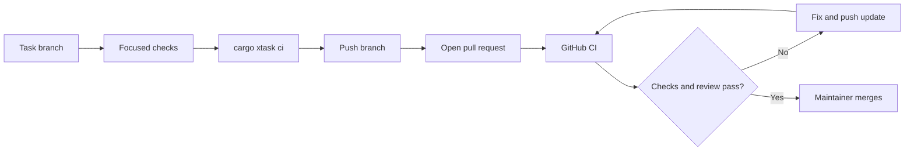
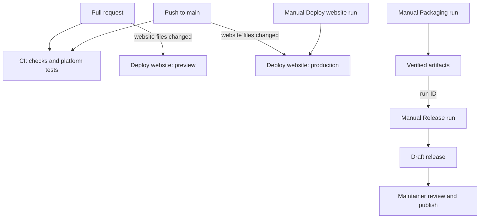

# Contributing to NoteCraft

Thanks for taking the time to improve NoteCraft. This guide starts with the smallest useful local loop and follows a change through tests, review, CI, and release. For project rules and the full skill inventory, see [`AGENTS.md`](AGENTS.md). For setup detail and quality gate definitions, see [`README_DEV.md`](README_DEV.md) and [`SKILLS/nc-devx/SKILL.md`](SKILLS/nc-devx/SKILL.md).

## 1. Get the project running

NoteCraft is a Rust desktop application. Install Rust with rustup and the platform build tools listed by the setup guide. From the repository root:

```bash
# Linux
bash SKILLS/nc-devx/scripts/setup.sh

# macOS
bash SKILLS/nc-devx/scripts/setup.mac.sh

# Windows PowerShell
.\SKILLS\nc-devx\scripts\setup.ps1
```

The setup scripts check or install the pinned toolchain and platform dependencies, enable the Git hooks, and build the development helper. To check a machine without changing it, use `-CheckOnly` on Windows or `CHECK_ONLY=1` with the Unix setup script. See [`README_DEV.md`](README_DEV.md) for the macOS setup variant and manual setup.

Build and launch the app with the bundled sample notebooks:

```bash
cargo run -p notecraft
```

The command-line app is `notecraft-cli`. Run `cargo run -p notecraft-cli -- --help` to see its commands.

## 2. Find the right project guidance

Start with the skill inventory below. Pick the smallest set that covers your change. A typical feature uses `nc-hl-design` to shape the work, the narrowest relevant implementation skill, and `nc-code-rust` for Rust practices; `nc-devx` covers setup and checks. Skills state their ownership and handoffs so related concerns have a clear home.

| Skill | Scope and responsibilities | Boundaries and handoffs |
|---|---|---|
| [`nc-arch`](SKILLS/nc-arch/SKILL.md) | System architecture, MVC boundaries, crate layers, ownership, data flow, and cross-platform constraints. | Routes feature design to `nc-hl-design`; does not define feature details or UI polish. |
| [`nc-arch-x-plat`](SKILLS/nc-arch-x-plat/SKILL.md) | Cross-platform rule: use each platform's capabilities, platform-suffixed files, `cfg`-gated wiring, and visible disclosure for missing support. | Applies within `nc-arch` and platform-touching features; does not own feature design. |
| [`nc-hl-design`](SKILLS/nc-hl-design/SKILL.md) | Feature scope, architecture handoff, state and data flow, decisions, risks, and acceptance criteria. | Routes detailed work to the relevant specialist; does not replace architecture or implementation guidance. |
| [`nc-prod`](SKILLS/nc-prod/SKILL.md) | Product requirements, local-file model, OneNote behavior, import, and format parity. | Does not design crate APIs or implement features. |
| [`nc-dom-ser`](SKILLS/nc-dom-ser/SKILL.md) | HTML and CMGFM page model, DOM semantics, serialization, assets, round trips, and cross-format parity. | Consult `nc-arch` and route feature design through `nc-hl-design`; does not own general architecture or UI styling. |
| [`nc-code-rust`](SKILLS/nc-code-rust/SKILL.md) | Rust quality, error handling, logging, tests, linting, and maintainable implementation. | Implements the approved design; does not decide product scope or architecture. |
| [`nc-uiux-features`](SKILLS/nc-uiux-features/SKILL.md) | End-to-end user features across ribbon, page content, storage integration, persistence, accessibility, and regression tests. | Consult `nc-dom-ser` and `nc-arch` for storage or architecture boundaries. |
| [`nc-uiux-controls`](SKILLS/nc-uiux-controls/SKILL.md) | Buttons, menus, hit targets, hover states, keyboard behavior, selection, and dragging. | Consult `nc-uiux-z-order` for overlapping surfaces; does not own dialog theming, persistence, or product scope. |
| [`nc-uiux-dialogs`](SKILLS/nc-uiux-dialogs/SKILL.md) | Themed dialogs, confirmations, progress, privacy and recovery prompts, and error states. | Consult `nc-uiux-controls` for interaction and `nc-uiux-z-order` for modality, stacking, and focus; does not own command behavior or persistence. |
| [`nc-uiux-bidi`](SKILLS/nc-uiux-bidi/SKILL.md) | Bidirectional text, RTL controls, caret placement, selection, mixed scripts, and mirrored layout. | Consult `nc-dom-ser` for persisted page representation; does not own general serialization. |
| [`nc-uiux-i18n`](SKILLS/nc-uiux-i18n/SKILL.md) | UI string extraction, locale catalogs, language preference, fallback, coverage audits, and localization verification. | Consult `nc-uiux-bidi` for RTL behavior and `nc-ua` for localized help and demo content; does not own notebook content translation. |
| [`nc-themes`](SKILLS/nc-themes/SKILL.md) | Theme tokens, contrast, borders, typography, state colors, modal surfaces, and visual regression. | Does not own individual feature behavior or dialog flow. |
| [`nc-uiux-drawing`](SKILLS/nc-uiux-drawing/SKILL.md) | Handwriting, drawing tools, stylus pressure, ink selection, and OneNote-compatible drawing workflows. | Consult `nc-dom-ser` for stored ink and `nc-themes` for visual tokens; apply `nc-uiux-z-order` when ink, page content, and controls overlap. |
| [`nc-uiux-z-order`](SKILLS/nc-uiux-z-order/SKILL.md) | Visual stacking, pointer ownership, modality, focus, and hit testing across content and overlays. | Routes control, dialog, drawing, and serialization details to `nc-uiux-controls`, `nc-uiux-dialogs`, `nc-uiux-drawing`, and `nc-dom-ser`. |
| [`nc-uiux-icons`](SKILLS/nc-uiux-icons/SKILL.md) | Licensed icon selection, local assets, semantic mapping, accessibility, and icon-state consistency. | Consult `nc-dom-ser` and `nc-themes` where relevant; does not own Windows Shell asset extraction or page serialization. |
| [`nc-uiux-testing`](SKILLS/nc-uiux-testing/SKILL.md) | UI automation, semantic interaction tests, screenshots, visual assertions, accessibility testing, and platform automation boundaries. | Consult `nc-ua` for help/demo assets and `nc-reelase-signoff` for release evidence; does not own product documentation. |
| [`nc-runtime-diagnostics`](SKILLS/nc-runtime-diagnostics/SKILL.md) | Local logs, telemetry sessions, settings and paths, event schemas, redaction, export/clear, and troubleshooting evidence. | Consult `nc-prod` for privacy policy, `nc-code-rust` for implementation, `nc-arch` for architecture, and `nc-devx` for developer environment. |
| [`nc-ua`](SKILLS/nc-ua/SKILL.md) | User assistance, product coverage, multilingual demo content, generated outputs, scratch copies, screenshots, and demo consistency. | Uses `nc-uiux-testing` for capture and automation; does not replace design or implementation. |
| [`nc-reelase-signoff`](SKILLS/nc-reelase-signoff/SKILL.md) | Release versioning, demo parity, tests, lint, packaging, installers, assets, and release evidence. | Does not implement features or waive failing gates. |
| [`nc-devx`](SKILLS/nc-devx/SKILL.md) | Machine setup, check scripts, L0-L4 quality levels, Git hooks, coverage, PII scanning, and daily developer workflow. | Owns how work is checked, not product decisions or architecture. |

Before changing behavior, read the relevant architecture or feature documents and tests. Keep the product's plain-file storage, cross-platform behavior, and clean-room constraints in view. For user-facing behavior, write down observable acceptance criteria and add a regression or feature test before or alongside the implementation.

## 3. Make a focused change and get fast feedback

Use a task branch rather than working on `main`. Choose a descriptive prefix such as `feat/`, `fix/`, `docs/`, or `test/`. Keep each change focused and preserve unrelated edits.

While iterating, format and check the affected crate or test:

```bash
cargo fmt --all
cargo check -p <crate>
cargo test -p <crate>
```

For behavior changes, run the focused regression test first. For a UI change, follow [`docs/testing.md`](docs/testing.md) and the `nc-uiux-testing` skill. Do not commit screenshot goldens; the UI harness captures and compares them during the test.

Common project checks include:

```bash
cargo xtask i18n-audit  # translation catalogs and hard-coded UI string coverage
cargo xtask demo-check   # generated demo and HTML/CMGFM consistency
cargo xtask docs         # documentation links
cargo xtask text         # text policy checks
```

Use `cargo xtask demo` only after changing authored demo content under `docs/demo/scripts/content`; generated notebooks under `docs/demo/DemoNotebook` are outputs and should not be hand-edited.

## 4. Run the full local gate

Before requesting review, run the same full quality gate used by the local pre-push hook:

```bash
cargo xtask ci
git diff --check
```

`cargo xtask ci` covers formatting, clippy, workspace tests, and repository checks for layers, assets, documentation, text, and demo parity. Enable hooks once per clone if setup did not do it:

```bash
git config core.hooksPath .githooks
```

The pre-commit gate checks branch naming, staged content, PII, formatting, crate layers, assets, docs, and text. The pre-push gate checks that the branch is current with `origin/main`, scans PII, and runs the full CI gate. Fix a failing check and rerun it; do not bypass hooks.

## 5. Commit and open a pull request

Use a short conventional commit subject, for example:

```text
fix(editor): preserve selection after undo
```

Push your task branch to your fork or to a branch on the official repository, then open a pull request against `main`. Include:

- The behavior or problem being addressed and why.
- The relevant issue or design decision, if one exists.
- The exact focused and full checks run, with results.
- Screenshots or recordings for visible UI changes, and any platform-specific limits.

Keep the pull request narrow and reviewable. Respond to review by updating the branch and rerunning affected checks. The required CI workflow runs formatting, clippy, static checks, demo checks, and builds/tests on Linux, Windows, and macOS. Coverage is reported as a warning and does not block a merge. A maintainer merges after required checks and review are satisfied.

The usual contributor path is:



**In short:** validate locally, open a PR, fix any CI or review findings, then a maintainer merges.

## 6. Understand CI and delivery

These are the GitHub Actions workflows contributors will see. A green source check does not mean a package or release exists:

1. **CI** (`.github/workflows/ci.yml`) runs on PRs and pushes to `main`: formatting, clippy, static checks, demo checks, and Linux/Windows/macOS build and tests. Coverage is visible and nonblocking.
2. **Deploy website** (`.github/workflows/deploy-website.yml`) runs for website changes on `main`, creates previews for website changes in PRs, and can be run manually to redeploy the current `main` tip.
3. **Packaging** (`.github/workflows/packaging.yml`) is started manually from GitHub Actions. It builds and verifies platform artifacts, then uploads them. It does not publish a release.
4. **Release** (`.github/workflows/release.yml`) is started manually with the ID of a successful Packaging run. It drafts a release using those exact artifacts; it does not rebuild them.
5. **Publication** happens after a maintainer reviews the draft, installation evidence, and release notes. See [`docs/releasing.md`](docs/releasing.md).



**In short:** CI checks code, website actions deploy previews or the site, Packaging creates artifacts, and Release drafts from a selected Packaging run.

Contributors should not start packaging or release workflows for an ordinary pull request. Packaging, signing, deployment, and publication are separate from code review and require maintainer coordination.

## 7. Where to ask and what to include

Use the project's GitHub issues for bugs and feature discussion. Before reporting a bug, check whether it is already tracked. Include the NoteCraft version, operating system, reproducible steps, expected and actual behavior, and relevant sanitized logs. Never attach private notebook contents, credentials, personal paths, or unreviewed diagnostic logs.

For OneNote format research, use public specifications and document sources in the research journal. NoteCraft is a clean-room project: do not use Microsoft source code, decompiled binaries, or copied proprietary assets.
