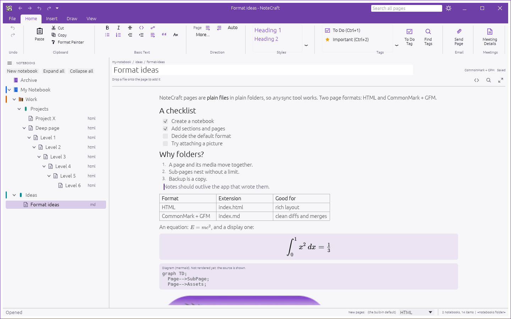
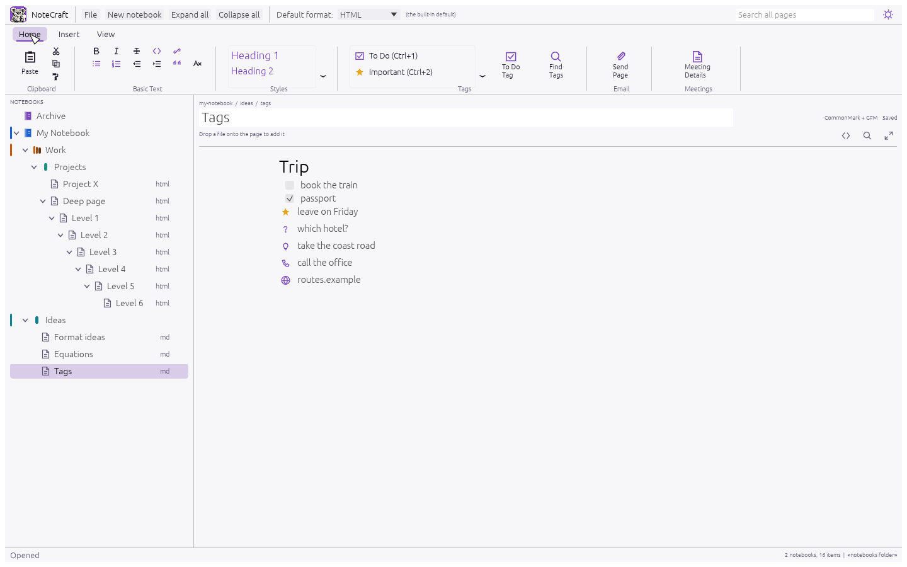
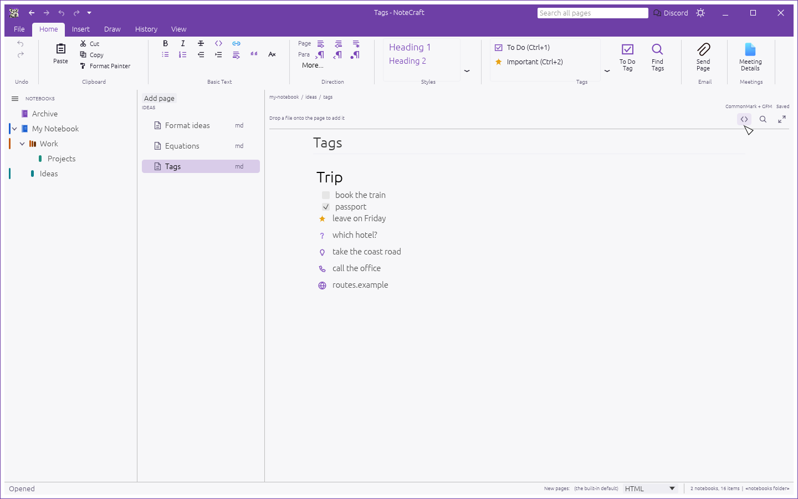
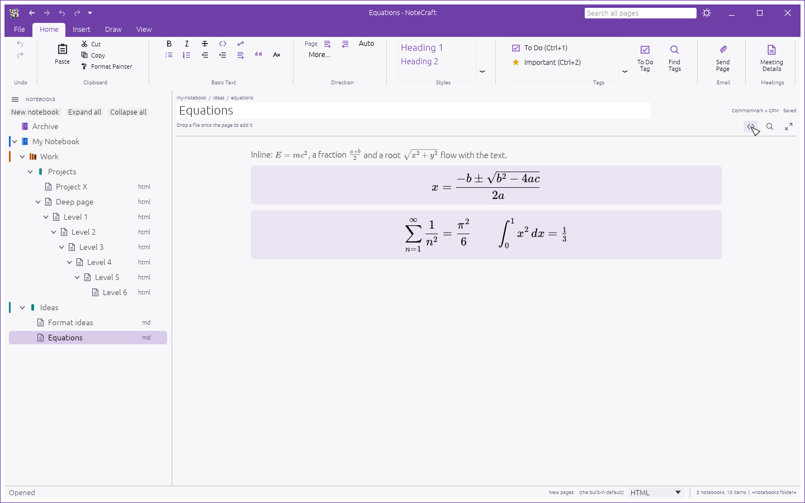
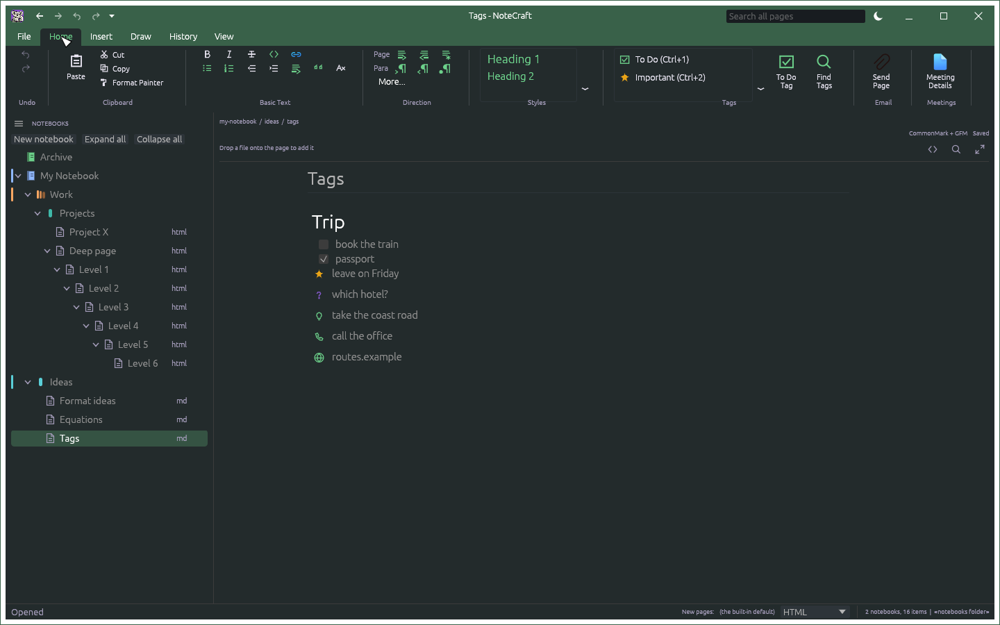
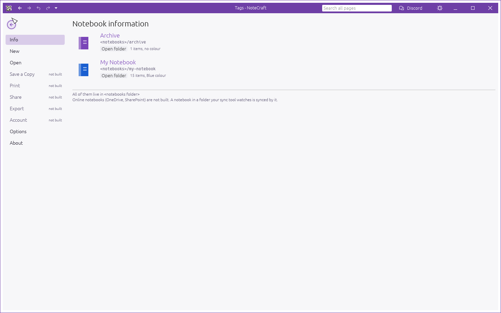
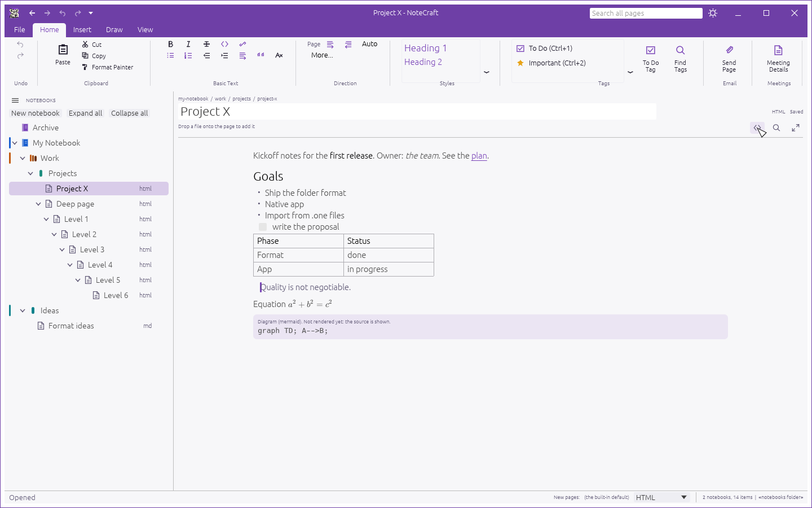
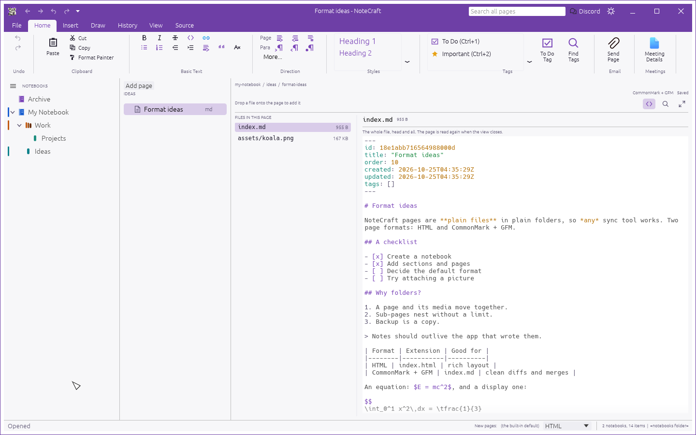

<p align="center">
  <picture>
    <source media="(prefers-color-scheme: dark)" srcset="assets/brand/notecraft-social-dark.png">
    
  </picture>
</p>

<p align="center">
  <b>Note taking and organization, written in pure Rust: an open, clean-room notebook app for people who want their notes to stay files.</b>
</p>

<p align="center">
  Notebooks, section groups, sections and pages are plain folders on your disk, and a page is
  one HTML or Markdown file beside its pictures. Any folder your sync tool already watches
  becomes a synced notebook. No server, no account, no database.
</p>

<p align="center">
  <a href="https://github.com/AlienTechSoftware/notecraft/actions/workflows/ci.yml"></a>
  
  
  
  
</p>

<p align="center">
  
  <br><sub><b>The sample notebooks.</b> The ribbon, coloured notebooks and sections, and a page written in the type it will be read in.</sub>
</p>

<p align="center">
  <a href="#a-tour">A tour</a> ·
  <a href="#why-notecraft">Why NoteCraft</a> ·
  <a href="#what-works-today">What works today</a> ·
  <a href="#quick-start">Quick start</a> ·
  <a href="#downloads">Downloads</a> ·
  <a href="#how-your-notes-are-stored">How your notes are stored</a> ·
  <a href="docs/how-to">How to</a> ·
  <a href="#for-agents-and-scripts">For agents and scripts</a> ·
  <a href="#architecture">Architecture</a> ·
  <a href="#how-it-is-tested">How it is tested</a> ·
  <a href="#status-and-what-is-missing">Status</a> ·
  <a href="#credits-and-licence">Credits and licence</a>
</p>

## A tour

Every picture below is NoteCraft itself, drawn off screen by its own test harness
(`cargo xtask screenshots`), not a mock-up.

<table>
<tr>
<td width="50%" valign="top"><p align="center"><sub><b>Home.</b> An Office-style ribbon: groups, galleries for styles and tags, and the controls that are not built yet say so.</sub></p></td>
<td width="50%" valign="top"><p align="center"><sub><b>Tags.</b> To Do, Important, Question, Idea and the rest, written into the page as plain text and drawn as the marks you already know.</sub></p></td>
</tr>
<tr>
<td width="50%" valign="top"><p align="center"><sub><b>Equations.</b> A TeX subset drawn natively: fractions, roots, sums, integrals and scaled brackets.</sub></p></td>
<td width="50%" valign="top"><p align="center"><sub><b>14 themes.</b> Light and dark, seven accents each, every colour checked for contrast by a test.</sub></p></td>
</tr>
<tr>
<td width="50%" valign="top"><p align="center"><sub><b>File.</b> Your notebooks and where they live on disk. Anything not built says so instead of hiding.</sub></p></td>
<td width="50%" valign="top"><p align="center"><sub><b>Both formats.</b> A page is HTML or CommonMark; the same editor, the same look, the file stays in its own format.</sub></p></td>
</tr>
<tr>
<td colspan="2" valign="top"><p align="center"><sub><b>Inside a page.</b> The files a page owns, and what is in each: the whole page file, head and body, to read and to edit.</sub></p></td>
</tr>
</table>

## Why NoteCraft

- **Your notes are files.** A notebook is a folder. A page is `index.html` or `index.md` with its
  pictures beside it. Open them in any editor, grep them, put them in git, or delete the app.
- **You can look inside.** A OneNote section is one binary file, and a text editor shows noise.
  NoteCraft's page source view lists every file a page owns and shows what is in each, the page's
  own text with its head, the drawing, the pictures, so you can check what your notes contain
  without taking anyone's word for it. See [Look inside a page](docs/how-to/look-inside-a-page.md).
- **Sync is your sync.** Put a notebook in the folder OneDrive, Dropbox, Syncthing or iCloud
  already watches. There is no NoteCraft server and no account.
- **No depth limit.** Note taking apps usually cap sub-pages at a level or three, because their
  file format says so. Here a page is a folder, so pages nest as deep as you like.
- **Familiar.** The Office-style ribbon, the File screen, coloured notebooks and sections, tags,
  to-do boxes, a page you write on directly. Nothing new to learn.
- **Fast and small.** One Rust binary on the GPU through [egui](https://github.com/emilk/egui).
  No Electron, no browser engine, no database.
- **Scriptable.** Every action is a command with an id, shared by the window, a command line, a
  loopback control channel and an MCP server, so an assistant can use your notes without a
  cloud account.
- **Honest.** Everything unfinished is written down in [docs/gaps.md](docs/gaps.md) and
  [ROADMAP.md](ROADMAP.md). The app says "not built" where it means it.

## What works today

| Area | What you get |
|---|---|
| **Structure** | Notebooks, section groups, sections and pages as folders; sub-pages to any depth; expand and collapse at every level; a new notebook starts with a section and a page, the way you expect |
| **Writing** | Write straight on the page in its finished look: headings, bold, italic, links, quotes, lists. Enter splits the line at the caret, Tab indents a list item, Backspace joins lines |
| **Two formats** | HTML (the default) and CommonMark + GFM, chosen per page, per section, per notebook or globally; the file keeps its own format when you edit it |
| **Containers** | A page is a sheet of boxes, not one column: move a box by the bar on top, resize it by the right edge; select one whole to cut, copy or delete it; each box is an element in the page's own text |
| **Page source** | The `< >` button opens the page's folder: every file the page owns on the left, the one you pick on the right. The page file shows its head (id, title, dates) above its body, which you can edit; a drawing's SVG shows as text, pictures as pictures, and a file nothing on the page uses is marked |
| **Right to left** | Arabic, Hebrew and the rest draw, with a direction for the page, the line or the run, kept in the text itself so it travels. Mixed lines are not reordered yet |
| **Tags** | To Do, Important, Question, Remember, Definition, Highlight, Contact, Address, Phone, Web site, Idea, Critical: stored as plain text in the page, drawn as the marks you know |
| **Equations** | KaTeX-style TeX maths drawn natively in real maths fonts, inline and display: fractions, roots, sums, integrals, matrices, cases, accents, with a gallery to start from |
| **Pictures and files** | Drop a file on the page: copy it into the page's folder or link to it where it is, and it asks which |
| **Colours** | Nine colours for notebooks, section groups and sections, saved in the folder |
| **Themes** | 14 themes, light and dark in seven accents, with contrast guaranteed by a test; a sun or moon switcher |
| **Finding things** | Search across every page of every notebook, with snippets |
| **Ribbon** | Home, Insert and View, with a Source tab that appears with the page source view; a File screen for whole notebooks |
| **Safety** | Autosave through a temporary file and a rename; a checker for the folder rules; every command tested against junk parameters |
| **Agents** | An MCP server on stdin and stdout: the tree, search, reading and writing pages, making notebooks, running any command; with the window open it can also see what you see |
| **Import** | A reader for `.one` section files, the ones the Office note taking app writes on Windows: the container, its objects and its pages. Writing them out as folders is being built |

The honest picture is in [docs/feature-parity.md](docs/feature-parity.md) (feature by feature
against the app most people are moving from) and [docs/gaps.md](docs/gaps.md) (what is missing
or unproven).

## Quick start

You need [Rust](https://rustup.rs).

```sh
cargo run --release -p notecraft                      # the app, on ~/Documents/NoteCraft
cargo run --release -p notecraft -- --notebooks ./my-notes
```

Try it on sample notebooks without touching your own:

```sh
cargo run -p notecraft-cli -- --notebooks ./demo sample
cargo run --release -p notecraft -- --notebooks ./demo --expand-all
```

## How your notes are stored

```text
Notes/                        the notebooks folder
  my-notebook/                notebook          _node.toml
    work/                     section group     _node.toml
      projects/               section           _node.toml
        project-x/            page              index.html + assets/
          index.html
          assets/diagram.png
          meeting-notes/      sub-page          index.md + assets/
    ideas/                    section           _node.toml (format = "cmgfm")
      format-ideas/
        index.md
```

A page carries its own metadata (title, id, order, created, updated) in front matter or in
`<meta>` tags, so a page is still a page after it is copied, moved or synced. The rules, down to
name length and conflict copies, are in [docs/folder-format.md](docs/folder-format.md).

## For agents and scripts

Every user-visible action is a command with an id, and every front end dispatches the same ones:

```sh
notecraft-cli commands                                  # every command and its parameters
notecraft-cli run notebook.create name=Work
notecraft-cli run node.create parent=work kind=page title="First page"
notecraft-cli tree
notecraft-cli search "quarterly"
notecraft-cli check work
```

The running window can be driven over a loopback port, which is how the screenshots above are
made and how the UI tests work:

```sh
notecraft --control 0        # prints nothing; the port and key are in control-key.local-PORT
```

It speaks JSON lines: `engine.execute`, `ui.open`, `ui.caret`, `ui.click`, `ui.key`, `ui.text`,
`ui.theme`, `ui.screenshot`, `ui.inspect`. See [docs/control-protocol.md](docs/control-protocol.md)
and the command list in [docs/commands.md](docs/commands.md), which a test keeps in step with the
code.

An assistant reaches the same commands over the **Model Context Protocol**, on stdin and stdout:

```sh
notecraft-cli mcp                  # the notebooks folder, nothing running
notecraft-cli mcp --connect 54321  # a running window, so it sees what you see
```

Tools for the tree, search, reading and writing pages, making notebooks and nodes, checking a
notebook, and running any command by id; resources for the tree, the commands and any page.
Deleting is not a tool of its own. It is stdio only: no network, no account, nothing uploaded.
See [docs/mcp.md](docs/mcp.md).

## Architecture

A Cargo workspace in layers. `cargo xtask layers` enforces that a crate only depends on lower
layers, and that nothing below the UI layer knows about egui.

| Layer | Crate | Job |
|---|---|---|
| L0 | `notecraft-model` | Node kinds, page formats, tags, name rules, ids, time |
| L1 | `notecraft-formats` | HTML and CommonMark: front matter, parsing into blocks, writing blocks back |
| L1 | `notecraft-math` | TeX maths typeset into drawing items (RaTeX, with a small engine of its own as the fallback) |
| L1 | `notecraft-onenote` | Reads `.one` section files: the revision store and its objects |
| L2 | `notecraft-store` | Notebooks as folders: the tree, pages, attachments, settings, search, the checker |
| L4 | `notecraft-engine` | The session and the command registry |
| L6 | `notecraft-ui-egui` | The window: tree, ribbon, the page and how it is written on, themes |
| apps | `notecraft`, `notecraft-cli` | The desktop window and the command line |
| tools | `xtask` | `cargo xtask ci` and friends |

More in [docs/architecture.md](docs/architecture.md). Guides for using it are in
[docs/how-to](docs/how-to): starting a notebook, writing a page, tagging a line, adding
pictures, syncing, choosing the page format, making it yours, scripting it, and what the
importer can read so far.

## How it is tested

```sh
cargo xtask ci     # fmt, clippy -D warnings, every test, layers, assets, links, text style
```

292 tests. The interesting ones:

- **Paired pixel tests.** Every icon is drawn by the app and by an independent reference in the
  same run and compared pixel for pixel, with negative controls that must fail. No golden images
  are committed, so nothing has to be regenerated on another machine.
- **A real window, driven headlessly.** The UI tests open the window off screen, click, type and
  read the page back through the control channel.
- **Contrast.** Every text and accent colour in all 14 themes is checked against its background.
- **Hostile input.** Every command runs with empty, huge, traversal and absolute-path parameters;
  the Markdown, HTML, TeX and `.one` readers are run on junk. Nothing may panic.
- **Round trips.** What the block writer writes, the parser reads back the same, for both page
  formats, so editing a page cannot quietly change it.
- **The MCP server over a pipe.** A whole conversation, from `initialize` to a notebook made,
  written, searched and checked, runs through the same stdio loop a client would use.

[docs/testing.md](docs/testing.md) explains the method, which follows the sibling Craft apps.

## Downloads

The first release is not published yet. When it is, the
[latest release](https://github.com/AlienTechSoftware/notecraft/releases/latest) will list the
builds below, and [all releases](https://github.com/AlienTechSoftware/notecraft/releases) will keep
the earlier versions and their notes. `<ver>` in a file name is the version number, and
`SHA256SUMS.txt` lists a checksum for every file.

| Build | Installer | Portable |
|---|---|---|
| Windows x64 (64-bit Intel and AMD) | `notecraft-<ver>-windows-x64.msi` | `notecraft-<ver>-windows-x64-portable.zip` |

Windows x64 is the only build. macOS and Linux are untested, so there are no builds for them; the
[Quick start](#quick-start) builds from source.

**The builds are not code-signed yet.** Windows SmartScreen may show "Windows protected your PC".
Choose More info, then Run anyway. Check the download against `SHA256SUMS.txt`, and for a release
built on GitHub, against its build attestation:
`gh attestation verify <file> --repo AlienTechSoftware/notecraft`.

The installer puts the program in Program Files and needs administrator rights. The portable zip
needs neither: unzip it and run `notecraft.exe`. Neither one touches your notebooks, which are
plain folders (by default `Documents\NoteCraft`), so removing the app never removes them.

Every release is an alpha and is marked a pre-release. [docs/releasing.md](docs/releasing.md) describes the
version numbers and how a release is built.

## Logs

The desktop app writes `notecraft.log` next to its settings: `%APPDATA%\NoteCraft\` on Windows. A
start from the Start menu has no terminal, so this file is what to attach to a bug report. It
records the start (version, folders), the window opening and closing, warnings and errors from the
graphics and window libraries, and any panic with its backtrace. Page text is not logged on
purpose, but a panic message can quote what the code was handling, so look before you share it. A log
over 1 MB moves to `notecraft.log.old`. `notecraft --version` and `notecraft-cli --version` print
the version and write no file.

## Status and what is missing

NoteCraft is **alpha**, version 0.0.2. It is not a ready product: it runs and it is tested, but
it is not finished, it has had little use, and a notebook you care about should have a backup. The
folder format can still change before 0.1. The other Craft apps describe themselves the same way.
What is missing:

- Built and run on **Windows only**. The code avoids OS features, but macOS and Linux are untested.
- **Right-to-left text is half there.** Arabic and Hebrew draw, and a page, a line or a run
  can be given a direction. A line that mixes the two directions is still drawn in one order,
  and the window is not mirrored. Measured, not assumed; the stages are in the roadmap.
- The caret belongs to egui, so **there is no selection across blocks**.
- **Import** reads a `.one` file's pages but does not write them into folders yet.
- **Mermaid diagrams** are stored and shown as source, not drawn.
- The koala artwork was generated by the owner with a licensed Windows Copilot (the owner's
  statement); it is not covered by the licence below. See [ATTRIBUTION.md](ATTRIBUTION.md).

**Versions.** The version is 0.0.2 and changes only when the project owner decides. NoteCraft follows the versioning of the Craft apps: `MAJOR.MINOR.PATCH`, still 0.x, tags like `v0.1.0`, and a hyphen such as `0.2.0-rc.1` for a pre-release. A minor release adds features, and a patch release only fixes bugs or rebuilds. We took this from the Craft apps' public tags and release guides, not from a written rule of theirs, and every release is marked a pre-release until the project says otherwise. See [docs/releasing.md](docs/releasing.md).

[ROADMAP.md](ROADMAP.md) has the order of work; [docs/gaps.md](docs/gaps.md) is the full list.

## Credits and licence

NoteCraft is a clean-room project. The `.one` reader is built from Microsoft's published
specifications ([MS-ONESTORE] and [MS-ONE]) and from using the app that writes those files,
never from its code or its assets. The notes behind the format work are in [docs/research](docs/research).

The icons in the window are drawn in code; there are no icon files. The fonts are the ones
[egui](https://github.com/emilk/egui) bundles. Everything in `assets/` and `docs/images/` has a
row in [ATTRIBUTION.md](ATTRIBUTION.md) saying where it came from, and a check fails the build if
one is missing.

NoteCraft is dual-licensed under [MIT](LICENSE-MIT) or [Apache-2.0](LICENSE-APACHE), at your
option, the same as the sibling Craft apps. Copyright (c) 2026 AlienTech Software and the NoteCraft
contributors; the required notices are in [NOTICE](NOTICE). The koala artwork is not covered by
it: the owner generated it with a licensed AI tool, see [ATTRIBUTION.md](ATTRIBUTION.md).
