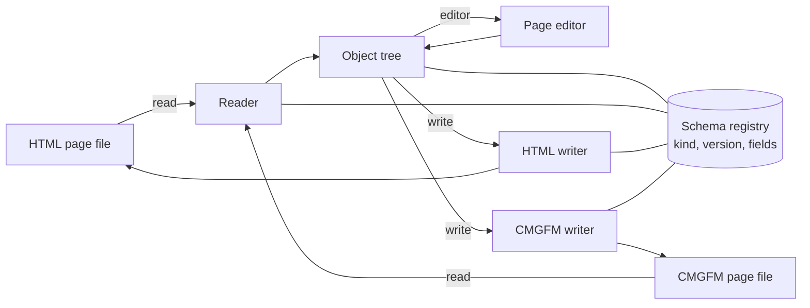
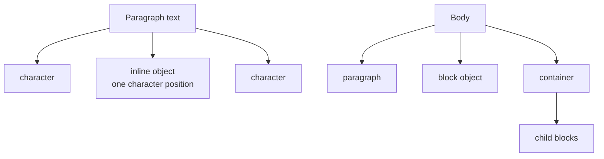
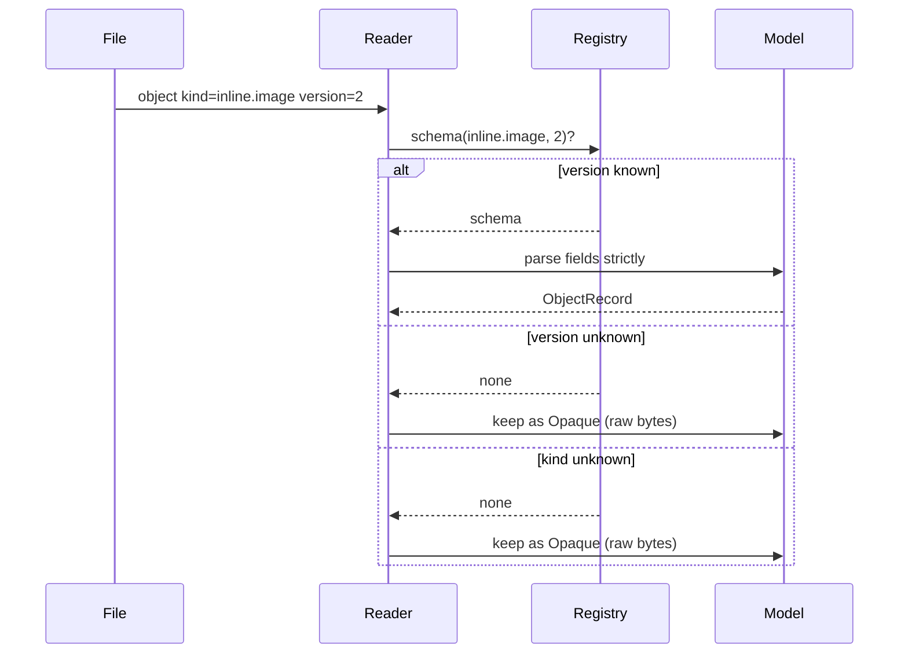
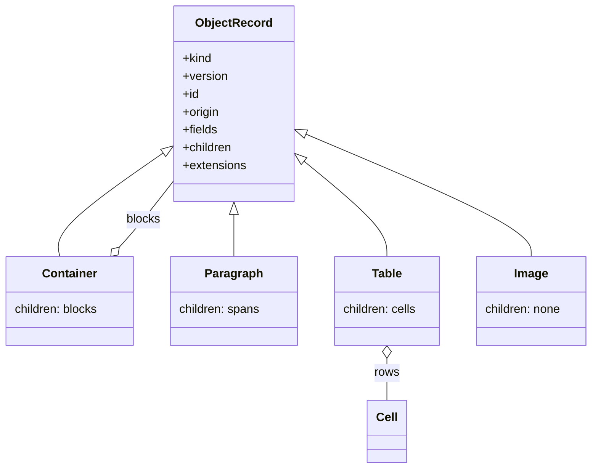

# RFC 0001: The NoteCraft document object model (DOM)

| Field | Value |
|---|---|
| RFC | 0001 |
| Title | The NoteCraft document object model |
| Status | Draft, for owner review. Not accepted. |
| Version of this RFC | `dom-rfc 0.1-draft` |
| Versioning | Independent of the app version. This RFC's version changes only when this document changes. |
| Owner | The NoteCraft owner, with `nc-dom-ser` as the working skill |
| Affects | `crates/formats`, `crates/model`, `crates/ui-egui` (page editor), page files in both formats, `docs/dom_serialization/` |
| Related | `SKILLS/nc-dom-ser/references/object-types.md`, `SKILLS/nc-dom-ser/references/naming-convention.md`, `SKILLS/nc-uiux-bidi/references/caret-options.md`, `SKILLS/nc-design-artcraft-integration/references/wordcraft_x_notecraft_dom.md` |
| Appendix | A: Integration with other Craft apps (WordCraft as primary candidate) |

---

## 1. Summary

NoteCraft pages are stored as HTML or CommonMark-plus-GFM files. In memory they are a tree of
objects. This RFC defines that tree: what an object is, how it is named, which fields it has, how
each field is versioned, which objects may contain other objects, and how objects that this build
does not understand are kept and written back unchanged.

It also fixes the rules that let the document model evolve without breaking old files, old builds,
or other Craft apps that later read the same objects.

## 2. Terms

- **DOM** here means the semantic page model: the tree the editor works on and the serializers read
  and write. It does not mean the browser DOM. This is the meaning already used in
  `docs/dom_serialization/README.md`.
- **Object**: one node of the tree. Every object has a kind, a version, an identifier and a payload.
- **Kind**: the identifier of an object type, in the form `family.kind` (for example `inline.image`).
  It is the contract that is stored in files.
- **Payload**: the fields of an object, as defined by its kind and version.
- **Schema**: the list of fields, types, requirements, children and extension points of one kind at
  one version.
- **Opaque object**: an object whose kind or version this build does not know. It keeps its original
  bytes and is written back unchanged.
- **Inline object**: an object that sits in a paragraph's text as one character position.
- **Block object**: an object that sits in the body as a block of its own.
- **Container**: an object whose payload is a list of child blocks.

## 3. Goals and non-goals

### 3.1 Goals

1. **Stable identity.** Every object type has a name that never changes once written.
2. **Explicit schema.** Every field is declared. Unknown fields are not silently accepted.
3. **Independent evolution.** A kind can gain a field or a new version without breaking older readers,
   and without forcing an app release.
4. **Lossless unknowns.** Objects this build does not understand survive a load and save.
5. **Format parity.** A page means the same thing in HTML and CommonMark-plus-GFM. Where one format
   cannot express an object, the RFC says so and says how the object is still preserved.
6. **Room for other apps.** An object created by another Craft app can live in a NoteCraft page and
   come back unchanged.
7. **Testable.** Every rule in this RFC has a test that the build runs.

### 3.2 Non-goals

- This RFC does not define the editor's caret or layout. That is `caret-options.md`.
- It does not change the folder format of notebooks, sections or pages.
- It does not define DOCX import or export. Appendix A only maps names.
- It does not define the details of style, attributes or formats. They are stored as part of the
  DOM (section 5.1), so this RFC names where they live and how they are versioned. Their content and
  rules are defined in their own specifications: the theme and UI skills for visual style, and
  `nc-dom-ser` and `docs/dom_serialization/` for file formats.

## 4. Architecture



The **schema registry** is the single source of truth for what a kind and version contains. The
reader, both writers, the editor and the tests all read the registry. No code keeps its own list of
fields.

Layers, following `cargo xtask layers`:

| Layer | Crate | Responsibility |
|---|---|---|
| Low | `notecraft-model` | The object tree types, identifiers, schema registry, version rules. No I/O. |
| Middle | `notecraft-formats` | Readers and writers for both formats. Uses the model. |
| High | `notecraft-ui-egui` | The page editor. Uses the model. Never defines a field itself. |

## 5. The object record

Every object, in memory and in the file, has the same record shape.

```rust
/// One object of the page tree. The payload is parsed only when the kind and version are known.
pub struct ObjectRecord {
    /// The contract: `family.kind`. Never changes once written.
    pub kind: Kind,
    /// Version of this kind's schema that the payload was written with.
    pub version: u16,
    /// Stable instance id within the page. Set when the object is created or imported.
    pub id: Option<ObjectId>,
    /// Where the object came from. Set once; kept on save.
    pub origin: Origin,
    /// Known fields, as the schema for `kind` and `version` defines them.
    pub fields: Fields,
    /// Child objects, only if the schema allows children for this kind.
    pub children: Vec<ObjectRecord>,
    /// Named extensions, only at the points the schema declares.
    pub extensions: Vec<Extension>,
}

/// The raw form of an object this build cannot interpret.
pub struct Opaque {
    pub kind: String,
    pub version: u16,
    pub id: Option<ObjectId>,
    pub origin: Origin,
    /// The payload exactly as read: HTML fragment, or CMGFM text, or both.
    pub raw: RawPayload,
}
```

| Field | Stored in file | Required | Notes |
|---|---|---|---|
| `kind` | yes | yes | The identifier. Format: `family.kind`. |
| `version` | yes | yes | Integer, starting at 1. See section 7. |
| `id` | yes, when present | no for inline objects that nothing refers to; yes once anything refers to them | Unique within its page. See section 6.3. |
| `origin` | yes | yes | `notecraft`, `onenote-import`, `wordcraft-import`, `ext.<vendor>`. Set once. |
| `fields` | yes | per schema | Only the fields the schema defines. Nothing else. |
| `children` | yes, when the kind allows children | per schema | Ordered. |
| `extensions` | yes, when present | no | Namespaced. See section 8. |

There is no catch-all field. Anything not in the schema is either an error (in a known version) or
the whole object is opaque (in an unknown version).

### 5.1 Style, attributes and formats

Three kinds of data are stored as part of the DOM. This RFC places them and versions them; it does not
define their content.

| Kind of data | Where it lives | Defined by |
|---|---|---|
| **Style** (named styles that objects refer to, for example a heading level or a character style) | a style table in the page header, referenced by `style` in an object's fields | a later RFC on styles |
| **Attributes** (typed properties of one object, for example width, alt text, alignment) | the object's `attrs`, declared in its schema | the kind's schema (section 10) |
| **Formats** (the page format and each object's format-specific form) | the page header (`data-nc-format`, `nc_format`) and the format mapping (section 9) | `nc-dom-ser` and `docs/dom_serialization/` |

Rules that apply to all three, and that this RFC does define:

1. Each is stored in the file, so a reader that loads a page and writes it back keeps them.
2. Each is versioned with the object or page that uses it: a style table has its own version, and an
   attribute change follows the kind's version rules (section 7.2).
3. An unknown style name is kept as it is, like an unknown object. It is not replaced by a default.

## 6. Identity, naming and placement

### 6.1 Three names per kind

| Name | Rule | Stored |
|---|---|---|
| Kind (identifier) | `family.kind`, lower case, dot separated | yes |
| Rust name | PascalCase; WordCraft's name where WordCraft has the object | no |
| Format form | HTML tag and class; CMGFM syntax | no (derived) |

Families are fixed: `block`, `inline`, `container`, `onenote`, `ext`. A new family needs an ADR.

Full rules and the table of kinds are in `naming-convention.md` and `object-types.md`. This RFC does
not repeat them; it depends on them.

### 6.2 Placement

Every kind is either inline or block. The schema says which.



An inline object occupies one character position in its paragraph's text. A block object is a body
child.

### 6.3 Object identity

An `ObjectId` is needed when something refers to an object: a comment, a link, a search result, a
caret placement, an ink stroke that belongs to an image, or an import match.

- Format: `o_` followed by 8 to 16 lower-case hex digits, unique within the page.
- Assigned when the object is created or imported, and kept on every save.
- An id is never reused in the same page, even after the object is deleted.
- An object without an id is not referenced by anything. Writers may omit it.

```html
<figure class="nc-block-image" data-nc-kind="block.image" data-nc-version="1" data-nc-id="o_7f3a91c2">
  
</figure>
```

## 7. Versioning

### 7.1 Two version lines

| Line | What it versions | Where it is stored |
|---|---|---|
| Format version | the file layout and the page header | `data-nc-format` in HTML; front matter key `nc_format` in CMGFM |
| Kind version | one object kind's fields | `data-nc-version` in HTML; a `version` attribute in the CMGFM object marker |

A page has one format version. Each object has its own kind version. A page can contain a kind at
version 1 and another at version 2.

### 7.2 When a version changes

| Change | Kind version | Compatibility |
|---|---|---|
| Add an optional field | no change | Old readers ignore it only if the field is optional and has a default; otherwise see below |
| Add a required field | new version | Old readers keep the object opaque |
| Remove a field | new version | Old readers keep the object opaque |
| Change a field's type or meaning | new version | Old readers keep the object opaque |
| Rename a field, same meaning | no change; add an alias for one version | Documented in the schema |
| Change allowed children | new version | Old readers keep the object opaque |
| Change allowed extensions | no change for adding a named point; new version for removing one | As above |

Rule: **an optional field may be added without a new version only if an old reader that ignores it
loses nothing when it writes the object back.** If in doubt, bump the version.

### 7.3 Reader behaviour



Writing:

- A known object is written from its fields, with its kind and version.
- An opaque object is written from its raw bytes, unchanged.
- The page's format version is the highest the writer needs for the objects it writes. It is never
  lowered on save.

### 7.4 Parse errors

A known kind and version with a missing required field, or with an unknown field, is an error. The
reader reports it with the object's kind, version, id and location. It does not guess. The page still
opens: the object is kept as opaque and the user is told, so nothing is lost.

## 8. Children and extensions

### 8.1 Children

Each kind declares what it may contain. Allowed values:

| Allowed children | Meaning | Example kinds |
|---|---|---|
| `none` | no children | `inline.image`, `block.rule`, `block.math` |
| `spans` | text runs with marks | `block.paragraph`, `block.heading`, `block.quote` |
| `blocks` | a list of block objects | `container.box`, `container.callout` |
| `cells` | table cells, each holding spans or blocks | `block.table` |



A child may not be of a kind its parent forbids. The reader checks this and treats a violation like a
parse error.

### 8.2 Extensions

An extension is a named piece of data attached to an object, keyed `ext.<vendor>.<name>`. Extensions
are how another Craft app, or a later NoteCraft feature, can add data to an object without changing
its kind.

Rules:

1. A kind declares its extension points in its schema: which names are allowed, and whether the point
   is per object or per field.
2. An extension is never a core field. A reader that does not know an extension keeps it and writes it
   back unchanged. A known field is never stored as an extension.
3. An extension has its own version. Its owner keeps it compatible.
4. An unknown extension never makes the object opaque. Only an unknown kind or version does.

Example (HTML):

```html
<figure class="nc-block-image" data-nc-kind="block.image" data-nc-version="1" data-nc-id="o_7f3a91c2">
  
  <script type="application/x-nc-ext" data-nc-ext="ext.artcraft.chart" data-nc-ext-version="1">{"series": []}</script>
</figure>
```

The script element is inert in HTML and is never executed; it is used only as a data carrier. The
exact carrier for each format is part of the format sections below and needs its own test.

## 9. Format mapping

### 9.1 HTML

- One `<figure>`, `<div>`, `<p>`, `<span>` or other element per object. The element is chosen by the
  kind's schema.
- Every object carries `data-nc-kind`, `data-nc-version`, and `data-nc-id` when it has an id.
- Known fields are written as attributes or as child elements, as the schema says. Text is text.
- Unknown objects are written as the raw element they were read from.

### 9.2 CommonMark plus GFM

CommonMark has no general object syntax. The rules:

- An object with a native CommonMark form uses it (for example `` for `inline.image`).
- An object without one is written as an HTML block with the same `data-nc-*` attributes, in a fenced
  marker that CommonMark renders as HTML. The marker is documented in the schema.
- The file's front matter carries `nc_format`.

```markdown
<!-- nc:begin kind="inline.callout" version="1" id="o_1b2c3d4e" -->
This is a callout inside a paragraph.
<!-- nc:end id="o_1b2c3d4e" -->
```

### 9.3 Parity

Both formats must mean the same page. The parity test compares the object tree read from each format.
Pixel parity is checked by hand, as `nc-dom-ser` already requires.

Where one format cannot express an object, the object is recorded in the parity exceptions with its
reason and its fallback. An owner decision is needed for each exception.

## 10. The schema registry

```rust
pub struct KindSchema {
    pub kind: &'static str,          // "inline.image"
    pub version: u16,                // 1
    pub placement: Placement,        // Inline or Block
    pub fields: &'static [FieldDef], // the only fields allowed
    pub children: ChildRule,         // None, Spans, Blocks, Cells
    pub extensions: &'static [ExtPoint],
    pub html: HtmlForm,              // element and attributes
    pub cmgfm: CmgfmForm,            // native syntax or marker
    pub status: Status,              // Current, Deprecated, Retired
}

pub struct FieldDef {
    pub name: &'static str,
    pub ty: FieldType,
    pub required: bool,
    pub since: u16,                  // the version that added it
}
```

Rules for the registry:

- Every kind that the code can produce is in the registry. A kind that is not in the registry is
  opaque on read.
- A `Retired` kind keeps its entry forever, so old files still read.
- The registry is generated or checked by a test against `object-types.md`. The two must match.

## 11. Testing

Each rule in this RFC has a test. Required test groups:

| Group | What it proves |
|---|---|
| Round trip, HTML | Read then write an HTML page; the bytes are the same except for normalised whitespace the RFC allows. |
| Round trip, CMGFM | The same for CommonMark-plus-GFM. |
| Parity | The object tree from an HTML page equals the tree from its CMGFM twin. |
| Unknown kind | A page with an unknown kind loads; the object is opaque; saving keeps its bytes. |
| Unknown version | A page with a known kind at a newer version loads; the object is opaque. |
| Unknown extension | An object with an unknown extension keeps it through a save. |
| Strict known version | A known kind with an unknown field is reported, not silently dropped. |
| Children rule | A forbidden child kind is reported. |
| Identity | Ids are unique in a page; a deleted id is not reused. |

```rust
#[test]
fn an_unknown_kind_survives_a_round_trip_unchanged() {
    let page = r#"<section data-nc-kind="onenote.future" data-nc-version="9">
        <p>kept</p></section>"#;
    let tree = read_html(page).expect("reads");
    let out = write_html(&tree);
    assert_eq!(normalise(&out), normalise(page));
}
```

Tests must not use mocks. Use real page files and the real readers and writers, per `AGENTS.md`.

## 12. Migration and compatibility

- The current model (`Block` and `Span` in `notecraft-formats`) is the starting point. Its types map to
  kinds in the registry; the mapping is written as a table in `object-types.md`.
- Existing files keep reading. A file with no kind or version is read as the current version of its
  implied kind.
- No file is rewritten on load. A file changes only when the user edits it, or when a migration is
  run on purpose, and the migration is listed in this RFC before it ships.
- Every change to the registry is a change to this RFC's version as well: a new field or version
  requires an entry in section 14.

## 13. Open questions

1. Whether a container's children can be a mix of blocks and tables. Proposed: yes, with the mix
   listed in the schema.
2. The exact CMGFM marker for objects that have no native syntax. Proposed: the HTML-block form in 9.2.
3. Whether `origin` is needed on every object or only on imported ones. Proposed: every object, so a
   later import can match.
4. How much of an opaque object's raw bytes is kept when a writer changes the page around it.
   Proposed: the whole raw form, unchanged.
5. The carrier for extension data in HTML (section 8.2). Proposed: the inert script element, to be
   confirmed by a test that the page's behaviour is unchanged.

## 14. Changelog of this RFC

| RFC version | Date | Change |
|---|---|---|
| 0.1-draft | 2026-11-12 | First draft. |
| 0.1-draft (r2) | 2026-11-12 | Style, attributes and formats are stored in the DOM; their details are deferred (sections 3.2, 5.1). |

---

## Appendix A: Integration with other Craft apps (WordCraft as primary candidate)

WordCraft is the primary candidate for integration: it already has a document model with fields,
objects, paragraphs and runs, and it is a Craft app that ships. This appendix maps NoteCraft's
proposed names to WordCraft's names, so that a shared object model, or an import and export between
the two, can be planned against one table.

### A.1 Sources and their status

| Source | Used for | Status |
|---|---|---|
| `storytold/wordcraft/crates/doc/src/block.rs` | `Block`, `Blocks` | read |
| `storytold/wordcraft/crates/doc/src/para.rs` | `Paragraph` | read |
| `storytold/wordcraft/crates/doc/src/para/run.rs` | `Run` | read |
| `storytold/wordcraft/crates/doc/src/para/inline_object.rs` | `InlineObject` variants | read |
| `storytold/wordcraft/crates/doc/src/position.rs` | `Pos` | read |
| `storytold/wordcraft/crates/doc/src/lib.rs` | `Document` | read |
| `storytold/wordcraft/crates/doc/src/control.rs` | content controls | read (header) |
| `storytold/wordcraft/crates/doc/src/cluster.rs` | cluster rules | read (header) |
| `storytold/wordcraft/docs/architecture.md` | list of model parts | read |
| `storytold/wordcraft/docs/typing-parity.md` | editing rules | read (sections) |
| WordCraft names not listed above (`Frame`, `ListItem`, `ContentControl`, `ChartSpec`, `Fill`) | named in the architecture notes and in an earlier survey | **to be verified** against the source before this appendix is accepted |

### A.2 Mapping table

Columns: NoteCraft kind (proposed), WordCraft name, relation, note.

Relations: **same** (same meaning), **close** (similar, with a difference noted), **none** (no WordCraft
equivalent), **WC-only** (WordCraft has it, NoteCraft does not propose it yet).

| NoteCraft kind | WordCraft name | Relation | Note |
|---|---|---|---|
| `block.paragraph` | `Block::Para(Paragraph)` | close | WordCraft's paragraph is one text stream with runs and objects; ours is spans per block. See the RFC's section 13 and the caret notes. |
| `block.heading` | paragraph with a heading style (`props`) | close | WordCraft has no heading kind; a heading is a style. |
| `block.item` | paragraph with list props (`ListItem` in the survey) | close | WordCraft's list membership is in paragraph properties. Verify the `ListItem` name. |
| `block.quote` | paragraph with a quote style | close | Style-based in WordCraft. |
| `block.code` | paragraph with a code style, or none | close | WordCraft has no code block kind in `Block`. |
| `block.math` | `InlineObject::Equation` in a paragraph, or an equation block | close | WordCraft's equations are inline objects. |
| `block.rule` | paragraph border or a section break | close | Different mechanism. |
| `block.table` | `Block::Table(Table)` | same | Cells, rows and nested content. |
| `block.container` | text box (`MAX_TEXT_BOX_DEPTH`) | close | WordCraft's text boxes nest to a depth limit. Verify whether the name is `Frame`. |
| `inline.image` | `InlineObject::Image` | same | |
| `inline.graphic` | `InlineObject::Graphic` | same | |
| `inline.shape` | `InlineObject::Shape` | same | |
| `inline.group` | `InlineObject::Group` | same | |
| `inline.field` | `InlineObject::Field` | same | |
| `inline.field.start` | `InlineObject::FieldStart` | same | |
| `inline.field.end` | `InlineObject::FieldEnd` | same | |
| `inline.control` | `InlineObject::ControlStart` and `ControlEnd` | same, paired | Pair markers in WordCraft; ours will also pair. |
| `inline.bookmark.start` | `InlineObject::BookmarkStart` | same | |
| `inline.bookmark.end` | `InlineObject::BookmarkEnd` | same | |
| `inline.comment.start` | `InlineObject::CommentStart` | same | |
| `inline.comment.end` | `InlineObject::CommentEnd` | same | |
| `inline.equation` | `InlineObject::Equation` | same | |
| `inline.ruby` | `InlineObject::Ruby` | same | |
| `inline.tab` | `InlineObject::PositionalTab` | close | WordCraft's is a positional tab stop, ours is a tab character. |
| `inline.break` | `LINE_BREAK` and `PAGE_BREAK` constants | same | WordCraft has them as characters in the text. |
| `inline.perm.start` | `InlineObject::PermStart` | same | Not yet proposed by NoteCraft. Listed for completeness. |
| `inline.perm.end` | `InlineObject::PermEnd` | same | As above. |
| `inline.note-ref` | `InlineObject::NoteRef` | same | Not yet proposed. |
| `ext.opaque` | `InlineObject::Opaque` | same | Both keep unknown content. |
| `onenote.ink` | none | none | OneNote ink has no WordCraft object. |
| `onenote.tag` | none | none | WordCraft has no OneNote tags. |
| `onenote.attachment` | `InlineObject::Image`, or a media part | close | WordCraft stores media in `Document::media`. |
| `onenote.pagelink` | a hyperlink run property | close | Not an object in WordCraft. |
| `onenote.stamp` | `InlineObject::Field` (date field) | close | Verify. |
| `onenote.audio` | none | none | |
| `onenote.video` | none | none | |
| `onenote.printout` | none | none | |
| `container.callout` | none | none | Proposed; no WordCraft equivalent. |
| WC-only: `Shape` group nesting, `ChartSpec`, `Fill` | `ChartSpec`, `Fill` (in the survey) | WC-only | Verify names. NoteCraft has no chart object yet. |

### A.3 What the mapping means

- Most inline kinds map one to one. The two models can exchange them without loss if the field sets
  agree. The field sets are not yet compared; that is the next step.
- The biggest difference is the text model. WordCraft's paragraph is one stream; ours is per-block
  spans. A shared model would need one of the two to change. This is the decision in
  `caret-options.md`, option B.
- OneNote-specific kinds have no WordCraft counterpart. They need `ext.artcraft.*`-style extensions if
  WordCraft is to carry them, or a shared `onenote` family in the shared library. The owner decides.

### A.4 Next steps for the integration

1. Verify every WordCraft name marked **to be verified** against the source.
2. Compare the field sets of each `same` row.
3. Decide whether the shared family is `ext.` (per app) or a shared crate.
4. Write the import and export tests for the `same` rows first.

---

## Appendix B: How this RFC will be used

- It lives in `SKILLS/nc-dom-ser/references/` until accepted.
- On acceptance, the owner moves it to `SKILLS/nc-design-artcraft-integration/references/` with
  Appendix A as the integration record.
- Changes to the RFC bump its own version (section 14). App versions do not change it.
