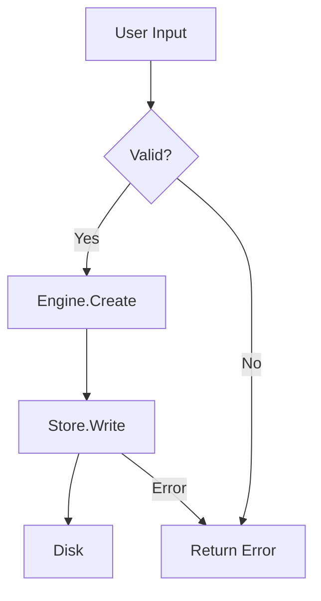

# nc-hl-design - NoteCraft High-Level Design

## Runtime and diagnostics baseline

Designs that add diagnostics or user settings must preserve NoteCraft's three build environments:
`debug` for local development, `release` for optimized artifacts, and `production` for the
installed release binary. Local collection has exactly five levels: `None`, `Usage`, `Warning`,
`Error`, and `Debug`. Debug defaults to `Debug`; release and production default to `None` unless
the user opts in. Settings live in the platform config directory, not beside the executable.
Telemetry means local usage and diagnostic records only. NoteCraft must not upload them.

## Core Constraint: Notebooks, Sections, Pages Are Folders

Every design decision flows from this:
- **Notebook** = one folder on disk (user can open it in file manager, copy it, sync it)
- **Section group** = subfolder
- **Section** = subfolder
- **Page** = one file (`.html` or `index.md`) + optional `_assets/` subfolder
- **Assets** = files in the page's `_assets/` folder, linked by relative path

Your feature lives *in* this folder tree. No database, no server, no magic. User owns the files.

## When to Use This Skill

Start with `/nc-hl-design` before:
- Adding a major new feature (new command, new format, new import path)
- Refactoring a system boundary (how crates talk to each other)
- Changing the data model (notebooks, pages, sections)
- Changing how DOM objects, tiles or containers resolve to page folders or assets
- Adding cross-platform support (Windows, macOS, Linux features)
- Major performance work (benchmarking new paths)

### DOM and page-folder ownership

When a design crosses the boundary between the rendered DOM and the on-disk page
tree - especially asset lookup, container ownership, or DOM-to-model identity - apply
[`nc-dom-ser`](../nc-dom-ser/SKILL.md) alongside this skill. The design must define
the model identity and controller query before specifying the view. The view must
not reconstruct page, section, notebook, or asset paths from DOM structure.

For small, scoped work (single-file bug fix, obvious config change), use `code-assistant` directly.

---

## Design Phase (Mandatory Before Implementation)

Follow this process. Do not skip to code.

### Step 1: Summarize Understanding

**What the requirement is:**
- What does the user want to build or change?
- Who are the users/stakeholders?
- What problems does it solve?

**Inputs and outputs:**
- What data enters the system?
- What data leaves?
- What state is created/modified?

**Constraints and assumptions:**
- Performance requirements? (real-time, background task, offline?)
- Data size? (notebook size, page count, file count?)
- Network? (sync, import, export?)
- Cross-platform? (Windows, macOS, Linux?)
- Integration? (OneNote, Obsidian, other tools?)

**Clarifying questions (if anything is vague):**
- Is this required or nice-to-have?
- Can it fail gracefully, or must it always succeed?
- Should it be fast or correct (or both)?
- Is there a reference implementation (OneNote, Notion, Obsidian)?

### Step 2: System Architecture & Data Flow

**Sketch the system as a diagram:**

```
User Input (Window/CLI)
    ↓
  Engine (Session, Commands)
    ↓
  Store (File I/O, Tree)
    ↓
  File System
```

**For the feature, identify:**

1. **Data flow** - where does data come in, where does it go, what transforms it?
   ```
   Input Page Title
      ↓
   [Engine.Page.Create]
      ↓
   [Store.WritePageMetadata]
      ↓
   Disk: page.html / index.md
   ```

2. **State machine** - what states can the system be in, what transitions are valid?
   ```
   States: Empty → Creating → Saved → Loading → Loaded → Error
   Valid: Creating → Saved | Error, Loaded → Error
   Invalid: Empty → Loaded (no transition)
   ```

3. **Ownership & lifecycle** - who creates, mutates, destroys objects?
   ```
   Session owns Notebook(path)
   Notebook owns Vec<Section>
   Section owns Vec<Page>
   Pages are immutable; mutations are logged to Session
   ```

4. **Concurrency** - is there shared mutable state? Multiple threads/tasks?
   ```
   Single-threaded UI main loop ✓
   Async file I/O with tokio ✓
   Race condition risk: autosave vs manual save → handle with locks
   ```

5. **Failure modes** - what can go wrong at each step?
   ```
   Input → Validation fails → Return PageError::InvalidTitle
   File I/O → Permission denied → Return PageError::PermissionDenied
   Disk full → Return PageError::DiskFull
   ```

### Step 3: Options & Estimates

Present **2-3 approaches** before implementation when:
- The feature is new (not a clear bug fix)
- Multiple reasonable designs exist
- Trade-offs are significant (speed vs. memory, complexity vs. flexibility)

**For each option, describe:**

| Field | Example |
|-------|---------|
| **Approach** | "Read entire notebook into memory on open; track changes; write back on save" |
| **Complexity** | Low / Medium / High |
| **Size** | S / M / L (relative to each other, not wall-clock time) |
| **Confidence** | tested / likely / unverified |
| **Trade-offs** | Fast to implement, high memory for large notebooks; Simpler error handling |

**Example decision table:**

| Approach | Complexity | Size | Memory | Disk I/O | Latency |
|----------|-----------|------|--------|----------|---------|
| **Eager load** | Low | S | High (large notebooks) | Once | Low |
| **Lazy load** | High | L | Low | On-demand | High |
| **Streaming** | Medium | M | Low | Constant | Medium |

**Recommendation:** Default to the simplest approach that meets requirements.

### Step 4: Design Artifacts

Before coding, deliver artifacts for each MVC layer. Follow this order: **Model → Controller → View**.

#### 4a. Model (Pure Data)

Design your data types with zero I/O or side effects:

```rust
// In crates/model/src/lib.rs
struct Notebook {
  id: String,
  name: String,
  maybe_path: Option<PathBuf>,  // local folder reference only
  sections: Vec<Section>,
  metadata: NotebookMetadata,
}

struct Section {
  id: String,
  name: String,
  pages: Vec<Page>,
}

struct Page {
  id: String,
  title: String,
  format: PageFormat,  // HTML or CommonMark
  blocks: Vec<Block>,
  maybe_parent_page_id: Option<String>,  // for sub-pages
}
```

**Rules:**
- No I/O (no file reads, no network, no timestamps)
- No mutable global state
- All logic is pure functions with clear inputs/outputs
- Types are fully serializable (for persistence, MCP)

#### 4b. Controller (Command & Orchestration)

Define commands that the controller will route. Each command is a request→response pair:

```rust
// In crates/engine/src/commands/page.rs
pub struct CreatePageRequest {
  notebook_id: String,
  title: String,
  format: PageFormat,
}

pub struct CreatePageResponse {
  page_id: String,
  created_at: DateTime<Utc>,
}

// The command handler in Session
impl Session {
  pub fn page_create(&mut self, req: CreatePageRequest) 
    -> Result<CreatePageResponse, EngineError> {
    // 1. Validate input
    if req.title.is_empty() {
      return Err(EngineError::InvalidTitle);
    }
    
    // 2. Call Store (I/O boundary)
    let page = self.store.create_page(
      &self.notebook_id,
      &req.title,
      req.format,
    )?;
    
    // 3. Update Session state (change log for undo/redo)
    self.changes.push(Change::PageCreated(page.id.clone()));
    
    // 4. Return response (View will render it)
    Ok(CreatePageResponse {
      page_id: page.id,
      created_at: page.created_at,
    })
  }
}
```

**Rules:**
- One command = one user action (create page, edit text, save, etc.)
- Commands own I/O boundaries (Store calls)
- Commands track changes (for undo/redo, autosave)
- Commands return Results; View handles errors

#### 4c. View (Presentation Only)

Wire the controller to UI. View is stateless about notebook data:

```rust
// In crates/ui-egui/src/commands.rs
impl UIState {
  fn on_create_page_clicked(&mut self, title: &str) {
    let req = CreatePageRequest {
      notebook_id: self.session.notebook_id.clone(),
      title: title.to_string(),
      format: PageFormat::Html,
    };
    
    // Call controller
    match self.session.page_create(req) {
      Ok(resp) => {
        // Update UI state: switch to new page, scroll to it
        self.current_page_id = Some(resp.page_id);
        self.show_status("Page created");
      }
      Err(e) => {
        // Show error to user
        self.show_error(&format!("Failed to create page: {}", e));
      }
    }
  }
}
```

**Rules:**
- View calls controller; controller never calls View
- View holds UI state only (window geometry, theme, scroll position)
- View does NOT hold notebook state (that's in Model/Controller)
- View responds to controller output

#### 4d. State Machine (Session Lifecycle)

Diagram the valid state transitions for your feature:

```
[Creating] --user-saves--> [Persisting] --OK--> [Saved]
             --error-----------^                  |
                                                  v
[Loaded] <--user-opens------ [Saved] --user-edits--> [Editing]
  |                                                      |
  +--error-at-load--> [Error]                  autosave |
                                                         v
                                                    [Saving]
```

Each transition corresponds to a command in your Controller.

#### 4e. Test Plan (Scenarios to Cover)
   ```
   ✓ Create page with HTML format (Model + Controller + View)
   ✓ Create page with CommonMark format
   ✓ Create sub-page (parent_page_id set)
   ✓ Create page with empty title → Controller rejects (Model never receives it)
   ✓ Create page in non-existent notebook → Store error caught by Controller
   ✓ Concurrent creates → each gets unique ID (Store guarantees)
   ✓ Page persists after create (Store writes file, Controller tracks change)
   ✓ View shows new page in sidebar (UI state updated after Controller response)
   ```

#### 4f. Error Catalog (All Failure Modes, by Layer)

**Model layer** (should never fail; invariants are enforced):
- Field validation happens before Model construction

**Controller layer** (catches and converts errors):
```rust
pub enum EngineError {
  InvalidTitle,
  NotebookNotFound,
  StoreError(StoreError),  // File I/O errors
}
```

**Store layer** (file system boundaries):
```rust
pub enum StoreError {
  PermissionDenied(PathBuf),
  DiskFull,
  Corrupted(String),
  NotFound(String),
}
```

**View layer** (displays errors to user):
- Controller returns Err; View shows message in status bar
- User can retry or abandon

---

## Before You Design: Read the Architecture

Before starting Step 1, read [nc-arch](nc-arch). It documents:
- **MVC pattern:** why NoteCraft uses MVC (not MVVM), controller ownership, model purity
- **Design patterns:** Command, Builder, Visitor, Strategy
- **Layered architecture:** UI → Engine → Store → Format → Model
- **Crate boundaries:** what imports what, module invariants
- **Data persistence:** folder structure, metadata format

This skill assumes you know those principles. The design process below applies them.

---

## Cross-Platform Considerations

### Pattern: Isolated Platform Implementations
If a feature is platform-specific:

```
clipboard.rs          # Shared interface and fallback
clipboard.win.rs      # Windows-specific (Win32 API)
clipboard.mac.rs      # macOS-specific (Cocoa)
clipboard.lnx.rs      # Linux-specific (X11/Wayland)
```

Build system selects the right implementation per platform.

### When to Use Platform Code
- **Yes:** Native file dialogs, system clipboard, notifications, keyboard shortcuts
- **No:** Cosmetic differences (use theme/config instead), language-specific syntax

### Testing Cross-Platform Features
- Run tests on all target platforms (or use CI)
- Mock native APIs where feasible
- Fall back to pure Rust on platforms without native support

---

## Testing Philosophy

This is the design-time view of the testing rules in `AGENTS.md` and `docs/testing.md`. A design
is not finished until its test plan (step 4e) shows how each scenario is tested under these rules.

### No mocks: test data first

- Tests use the real code with real or checked-in test data: sample notebooks, fixture files, real
  temporary folders, and recorded inputs.
- Do not write mocks, stubs, fakes or spies for code we own. Do not replace a dependency with a
  double because the real one is inconvenient to set up.
- Why: a mock encodes what we think a dependency does, so it drifts from the real behaviour and
  hides bugs at the seams. It also pushes test-only hooks into product code, which makes the product
  harder to read and change.
- When a test needs a scenario, build the data for it. Write a sample notebook or fixture file that
  has the shape the test needs, and keep it in the test folder or `docs/demo`.

### The one exemption: the clipboard

- The system clipboard may be replaced by a test double, Windows first. The double lives only in the
  test folder (`crates/*/tests/`).
- Product code gets no test hook of any kind: no `cfg(test)` branches, no test-only feature flags, no
  setters or injected backends that exist only for tests. This rule overrides the exemption.
- The app's clipboard calls currently go straight to the system clipboard, and no boundary exists
  that a test can reach. Until one exists through a change the app needs for itself, the clipboard
  tests use the real clipboard and run alone.
- No other platform service is exempt. A new exemption is written into `AGENTS.md` first.

### Isolation: a test owns its state

- A test creates its own temporary folder, its own notebooks and its own settings file.
- Tests must not share the system clipboard, environment variables, the working directory or a fixed
  folder. A test that shares any of these says so and runs alone.
- Two tests must be able to run in any order and in parallel. If they cannot, that is a bug in the
  tests, not a reason to run the whole suite serially.

### Parallel by default, serial by exception

- The gate runs the crates in parallel. Tests that cannot be isolated run alone, one binary at a
  time, and the gate says which ones.
- A flaky test is a failure. Diagnose it: find the shared state, then isolate it. Do not re-run it
  until it passes, and do not push past it. The gate must be green before a push.

### What a test plan must say (step 4e)

For each scenario:
- the test data it needs, and where that data lives;
- the real code path it exercises, with no double in the middle;
- whether it touches shared state, and if so how it is isolated or why it runs alone;
- the platform it runs on, and which platforms were not run.

## Design Checklist

Before moving to implementation, confirm:

- [ ] **Requirement** is clear (have you asked clarifying questions?)
- [ ] **Data model** is defined (structs + fields)
- [ ] **State machine** is documented (valid transitions only)
- [ ] **API boundary** is clear (commands, request/response types)
- [ ] **Error paths** are identified (what can fail, how to recover?)
- [ ] **Test plan** is drafted (happy path + edge cases)
- [ ] **Platform concerns** are addressed (single-platform or multi?)
- [ ] **Performance** target is set (real-time, background, no constraint?)
- [ ] **Design is reviewed** (get another pair of eyes before code)
- [ ] **User has approved** the approach (not the implementation, the approach)

---

## When Design Reveals a Problem

If during design you discover:
- The requirement is impossible or contradictory
- The approach requires architecture change
- Effort is much higher than expected
- A simpler alternative exists that you didn't know about

**Stop.** Do not proceed to implementation. Report the finding and get guidance before continuing.

---

## Output Formats

### Diagram (Mermaid)
Use for data flow, state machines, architecture:



### State Machine (Text)
```
[Creating] --save--> [Saving] --OK--> [Saved]
             --error--> [Error]       |
                                      v
[Loaded] <--load----- [Saved]
  |
  |--edit--> [Editing] --autosave--> [Saving]
```

### Table (Data structures, trade-offs)
```
| Crate | Purpose | Size | Status |
|-------|---------|------|--------|
| model | Core types | S | ✓ |
| store | File I/O | M | ✓ |
| engine | Commands | M | ✓ |
```

### Prose (One-liner per decision)
```
✓ Use a single Session per open notebook (not per page)
✓ Store metadata in .notecraft/notebook.json
✓ Pages are immutable during a session (changes logged, written on save)
✗ Do not use a database (local files only, user controls backup)
```

---

## Post-Design Handoff

When design is complete, deliver:

1. **Design doc** (this skill's output): data model, state machine, API, errors, tests
2. **Clear acceptance criteria:** "Done when pages persist to disk AND import handles tables AND RTL text renders correctly"
3. **Risk list:** "Unknown: whether file locks work on network shares"
4. **Estimate:** "Low uncertainty; L = 2-3 days"

Then move to `code-assistant` for implementation.

---

## References

- [NoteCraft Architecture](nc-arch) - design patterns and principles
- [Product Principles](nc-prod) - must-haves and deal-breakers
- [Code Quality Audit](C:\dev\p-NoteCraft\work\code-quality\implementation-audit.md) - existing system architecture
- [ArtCraft Patterns](C:\dev\p-NoteCraft\ideation\code-style-guide\architecture-artcraft.md) - proven patterns from sibling project

---

**Last updated:** 2026-10-24  
**Used for:** Major features, architectural changes, cross-platform work
