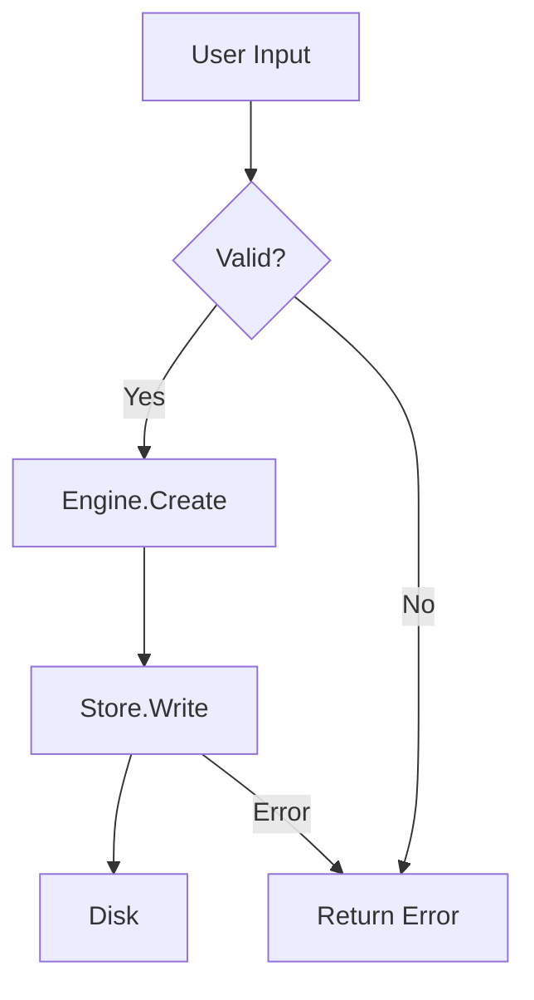

# nc-hl-design - NoteCraft High-Level Design

## Runtime and diagnostics baseline

Designs that add diagnostics or user settings must preserve NoteCraft's three build environments:
`debug` for local development, `release` for optimized artifacts, and `production` for the
installed release binary. Local collection has exactly five levels: `None`, `Usage`, `Warning`,
`Error`, and `Debug`. Debug defaults to `Debug`; release and production default to `None` unless
the user opts in. Settings live in the platform config directory, not beside the executable.
Telemetry means local usage and diagnostic records only. NoteCraft must not upload them.

## When to Use This Skill

Start with `/nc-hl-design` before:
- Adding a major new feature (new command, new format, new import path)
- Refactoring a system boundary (how crates talk to each other)
- Changing the data model (notebooks, pages, sections)
- Adding cross-platform support (Windows, macOS, Linux features)
- Major performance work (benchmarking new paths)

For small, scoped work (single-file bug fix, obvious config change), use `code-assistant` directly.

---

## Design Phase (Mandatory Before Implementation)

Follow this process. Do not skip to code.

### Step 1: Summarize Understanding

**What the requirement is:**
- What does the user want to build or change?
- Who are the users/stakeholders?
- What problems does it solve?

**Inputs and outputs:**
- What data enters the system?
- What data leaves?
- What state is created/modified?

**Constraints and assumptions:**
- Performance requirements? (real-time, background task, offline?)
- Data size? (notebook size, page count, file count?)
- Network? (sync, import, export?)
- Cross-platform? (Windows, macOS, Linux?)
- Integration? (OneNote, Obsidian, other tools?)

**Clarifying questions (if anything is vague):**
- Is this required or nice-to-have?
- Can it fail gracefully, or must it always succeed?
- Should it be fast or correct (or both)?
- Is there a reference implementation (OneNote, Notion, Obsidian)?

### Step 2: System Architecture & Data Flow

**Sketch the system as a diagram:**

```
User Input (Window/CLI)
    ↓
  Engine (Session, Commands)
    ↓
  Store (File I/O, Tree)
    ↓
  File System
```

**For the feature, identify:**

1. **Data flow** - where does data come in, where does it go, what transforms it?
   ```
   Input Page Title
      ↓
   [Engine.Page.Create]
      ↓
   [Store.WritePageMetadata]
      ↓
   Disk: page.html / index.md
   ```

2. **State machine** - what states can the system be in, what transitions are valid?
   ```
   States: Empty → Creating → Saved → Loading → Loaded → Error
   Valid: Creating → Saved | Error, Loaded → Error
   Invalid: Empty → Loaded (no transition)
   ```

3. **Ownership & lifecycle** - who creates, mutates, destroys objects?
   ```
   Session owns Notebook(path)
   Notebook owns Vec<Section>
   Section owns Vec<Page>
   Pages are immutable; mutations are logged to Session
   ```

4. **Concurrency** - is there shared mutable state? Multiple threads/tasks?
   ```
   Single-threaded UI main loop ✓
   Async file I/O with tokio ✓
   Race condition risk: autosave vs manual save → handle with locks
   ```

5. **Failure modes** - what can go wrong at each step?
   ```
   Input → Validation fails → Return PageError::InvalidTitle
   File I/O → Permission denied → Return PageError::PermissionDenied
   Disk full → Return PageError::DiskFull
   ```

### Step 3: Options & Estimates

Present **2-3 approaches** before implementation when:
- The feature is new (not a clear bug fix)
- Multiple reasonable designs exist
- Trade-offs are significant (speed vs. memory, complexity vs. flexibility)

**For each option, describe:**

| Field | Example |
|-------|---------|
| **Approach** | "Read entire notebook into memory on open; track changes; write back on save" |
| **Complexity** | Low / Medium / High |
| **Size** | S / M / L (relative to each other, not wall-clock time) |
| **Confidence** | tested / likely / unverified |
| **Trade-offs** | Fast to implement, high memory for large notebooks; Simpler error handling |

**Example decision table:**

| Approach | Complexity | Size | Memory | Disk I/O | Latency |
|----------|-----------|------|--------|----------|---------|
| **Eager load** | Low | S | High (large notebooks) | Once | Low |
| **Lazy load** | High | L | Low | On-demand | High |
| **Streaming** | Medium | M | Low | Constant | Medium |

**Recommendation:** Default to the simplest approach that meets requirements.

### Step 4: Design Artifacts

Before coding, deliver:

1. **Data model** (as Rust structs with comments):
   ```rust
   struct Notebook {
     id: String,
     name: String,
     maybe_path: Option<PathBuf>,  // local folder
     sections: Vec<Section>,
     metadata: NotebookMetadata,
   }

   struct Section {
     id: String,
     name: String,
     pages: Vec<Page>,  // flat or hierarchical?
   }

   struct Page {
     id: String,
     title: String,
     format: PageFormat,  // HTML or CommonMark
     blocks: Vec<Block>,
     maybe_parent_page_id: Option<String>,  // for sub-pages
   }
   ```

2. **State machine** (as a diagram or text description):
   ```
   enum PageState {
     Creating,
     Persisting,
     Loaded,
     Editing,
     Saving,
     Saved,
     Error(String),
   }

   Transitions:
     Creating → Persisting (user saves)
     Persisting → Saved | Error
     Loaded → Editing (user types)
     Editing → Saving (autosave timer)
     Saving → Saved | Error
   ```

3. **API boundary** (what the feature exposes):
   ```rust
   // Commands (Engine API)
   pub fn create_page(session: &Session, req: CreatePageRequest) 
     -> Result<Output, EngineError>

   // Request/Response types
   pub struct CreatePageRequest {
     notebook_id: String,
     title: String,
     format: PageFormat,
   }

   pub struct CreatePageResponse {
     page_id: String,
     created_at: DateTime<Utc>,
   }
   ```

4. **Test plan** (what scenarios to cover):
   ```
   ✓ Create page with HTML format
   ✓ Create page with CommonMark format
   ✓ Create sub-page (parent_page_id set)
   ✓ Create page with empty title → error
   ✓ Create page in non-existent notebook → error
   ✓ Concurrent creates → each gets unique ID
   ✓ Page persists after create (file on disk)
   ```

5. **Error catalog** (all failure modes):
   ```
   PageError::InvalidTitle (title empty or too long)
   PageError::NotebookNotFound (parent notebook doesn't exist)
   PageError::PermissionDenied (no write access)
   PageError::DiskFull (no space to write)
   PageError::Corrupted (metadata missing/invalid)
   ```

---

## Architectural Principles (Applied in Design)

### 1. Layered Architecture
```
┌─────────────────────────────────┐
│ UI Layer (egui, CLI)            │
├─────────────────────────────────┤
│ Engine (Commands, State)        │
├─────────────────────────────────┤
│ Store (File I/O, Tree)          │
├─────────────────────────────────┤
│ Formats (HTML, MD, CSV parsing) │
├─────────────────────────────────┤
│ Model (Types: Notebook, Page)   │
├─────────────────────────────────┤
│ File System (OS abstractions)   │
└─────────────────────────────────┘
```

Each layer depends only on layers below it. Horizontal dependencies (formats ↔ store) must go through clear interfaces.

### 2. Command Pattern
Every action goes through `Session::run(command, params)`:
- Window menu clicks → `session.run("page.create", ...)`
- CLI commands → `session.run("page.create", ...)`
- MCP/API calls → `session.run("page.create", ...)`

Single code path = single behavior, easier to test and debug.

### 3. Data Model as Source of Truth
- Notebooks, Sections, Pages are types in `notecraft_model`
- No "model X in the database, model Y in memory" duplication
- Store layer is I/O only; model lives in memory during a session

### 4. Local File Persistence
- Everything is a folder tree on disk
- No server, no cloud sync (user's sync tool handles that)
- One `Notebook` = one folder
- One `Page` = one `.html` or `index.md` file (+ optional assets folder)
- `.notecraft/` metadata folder in each notebook for version, created_at, etc.

### 5. Format Agility
- Pages support HTML and CommonMark (CMGFM)
- Format is per-page (set on creation, changeable later)
- Demo notebooks must stay in parity: same structure, same content, different formats
- Conversion tools may exist but are not required to round-trip perfectly

### 6. OneNote Compatibility
- Import path is smooth (not perfect conversion, but good)
- Look and feel familiar to OneNote users
- RTL text and script handling is best-in-class
- Import covers 90%+ of real OneNote notebooks (tables, images, text, formatting)

---

## Cross-Platform Considerations

### Pattern: Isolated Platform Implementations
If a feature is platform-specific:

```
clipboard.rs          # Shared interface and fallback
clipboard.win.rs      # Windows-specific (Win32 API)
clipboard.mac.rs      # macOS-specific (Cocoa)
clipboard.lnx.rs      # Linux-specific (X11/Wayland)
```

Build system selects the right implementation per platform.

### When to Use Platform Code
- **Yes:** Native file dialogs, system clipboard, notifications, keyboard shortcuts
- **No:** Cosmetic differences (use theme/config instead), language-specific syntax

### Testing Cross-Platform Features
- Run tests on all target platforms (or use CI)
- Mock native APIs where feasible
- Fall back to pure Rust on platforms without native support

---

## Design Checklist

Before moving to implementation, confirm:

- [ ] **Requirement** is clear (have you asked clarifying questions?)
- [ ] **Data model** is defined (structs + fields)
- [ ] **State machine** is documented (valid transitions only)
- [ ] **API boundary** is clear (commands, request/response types)
- [ ] **Error paths** are identified (what can fail, how to recover?)
- [ ] **Test plan** is drafted (happy path + edge cases)
- [ ] **Platform concerns** are addressed (single-platform or multi?)
- [ ] **Performance** target is set (real-time, background, no constraint?)
- [ ] **Design is reviewed** (get another pair of eyes before code)
- [ ] **User has approved** the approach (not the implementation, the approach)

---

## When Design Reveals a Problem

If during design you discover:
- The requirement is impossible or contradictory
- The approach requires architecture change
- Effort is much higher than expected
- A simpler alternative exists that you didn't know about

**Stop.** Do not proceed to implementation. Report the finding and get guidance before continuing.

---

## Output Formats

### Diagram (Mermaid)
Use for data flow, state machines, architecture:



### State Machine (Text)
```
[Creating] --save--> [Saving] --OK--> [Saved]
             --error--> [Error]       |
                                      v
[Loaded] <--load----- [Saved]
  |
  |--edit--> [Editing] --autosave--> [Saving]
```

### Table (Data structures, trade-offs)
```
| Crate | Purpose | Size | Status |
|-------|---------|------|--------|
| model | Core types | S | ✓ |
| store | File I/O | M | ✓ |
| engine | Commands | M | ✓ |
```

### Prose (One-liner per decision)
```
✓ Use a single Session per open notebook (not per page)
✓ Store metadata in .notecraft/notebook.json
✓ Pages are immutable during a session (changes logged, written on save)
✗ Do not use a database (local files only, user controls backup)
```

---

## Post-Design Handoff

When design is complete, deliver:

1. **Design doc** (this skill's output): data model, state machine, API, errors, tests
2. **Clear acceptance criteria:** "Done when pages persist to disk AND import handles tables AND RTL text renders correctly"
3. **Risk list:** "Unknown: whether file locks work on network shares"
4. **Estimate:** "Low uncertainty; L = 2-3 days"

Then move to `code-assistant` for implementation.

---

## References

- [NoteCraft Architecture](nc-arch) - design patterns and principles
- [Product Principles](nc-prod) - must-haves and deal-breakers
- [Code Quality Audit](C:\dev\p-NoteCraft\work\code-quality\implementation-audit.md) - existing system architecture
- [ArtCraft Patterns](C:\dev\p-NoteCraft\ideation\code-style-guide\architecture-artcraft.md) - proven patterns from sibling project

---

**Last updated:** 2026-10-24  
**Used for:** Major features, architectural changes, cross-platform work
