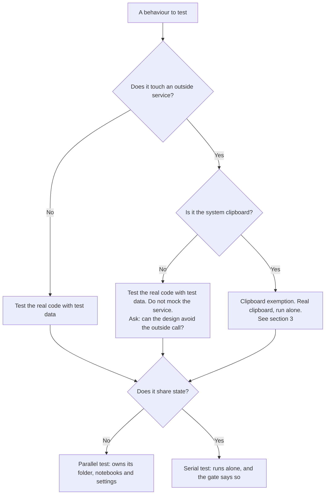
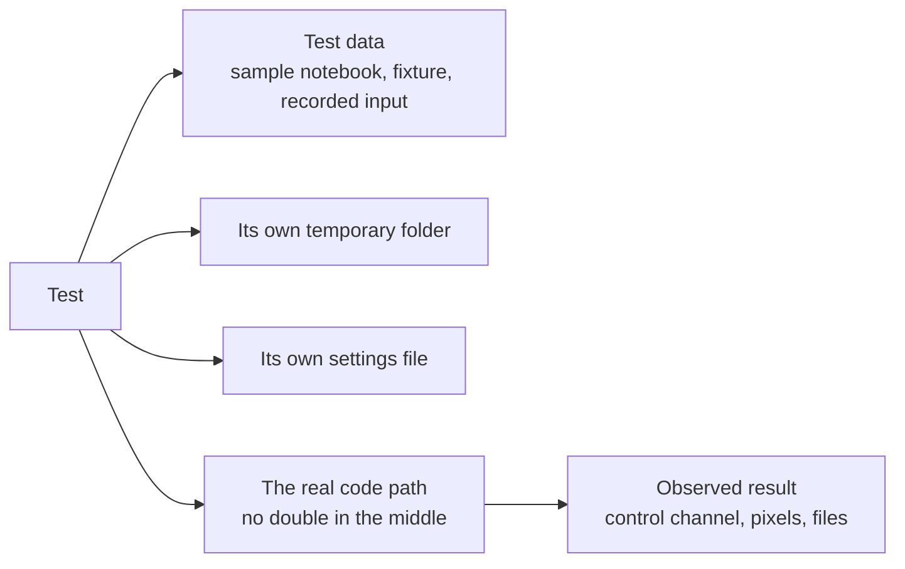
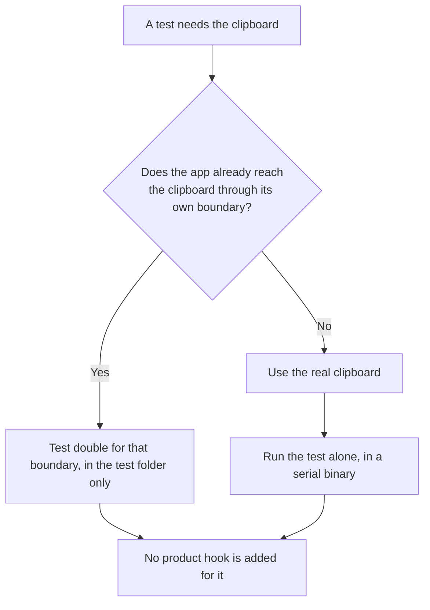
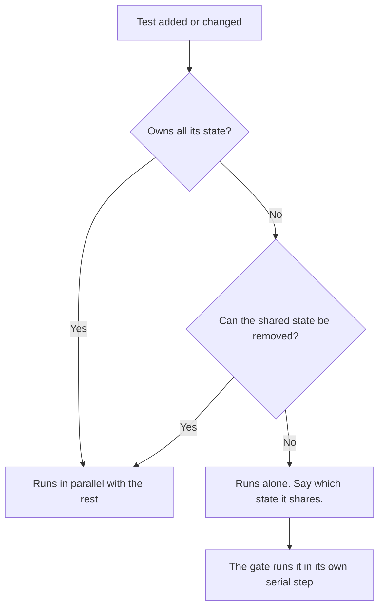
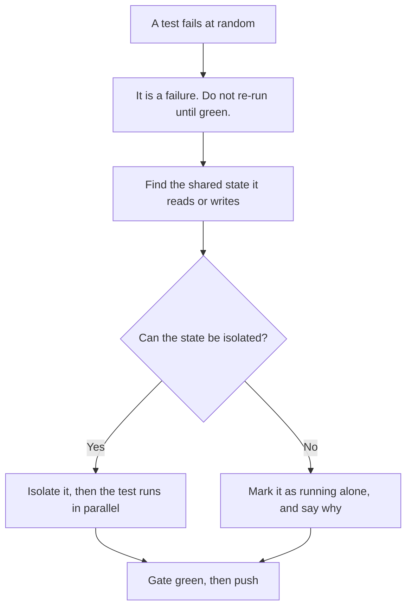

# Testing philosophy: the reasons and the decision paths

The rules themselves are in `SKILL.md` ("Testing Philosophy") and in `AGENTS.md`. This file shows how
they apply, with diagrams for the decisions a designer or tester makes.

## 1. Which kind of test does this need?

## 2. What a test is made of

A test may read shared resources only through the rules in section 3. It may not reach the
environment, the working directory or a fixed folder.

## 3. The clipboard exemption, step by step

The exemption never adds a hook to product code. Product code has no `cfg(test)` branch, no
test-only feature flag and no test-only setter.

## 4. Parallel or serial?

## 5. A flaky test

Never push past a failing gate. Never use `--no-verify`.

## Why no mocks

- A mock records what we believe a dependency does. When the real dependency behaves differently, the
  mock keeps passing and the bug reaches the user.
- A test double often forces test-only hooks into the product. Those hooks are then maintained with the
  product and read by its authors.
- Test data is part of the project. Anyone can read a sample notebook or a fixture file and see what
  the test covers.
