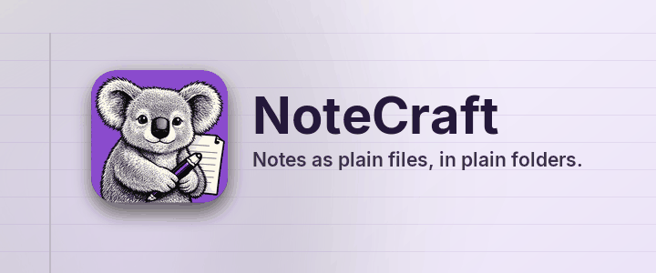

# Welcome

*Notes as plain files, in plain folders.*

NoteCraft keeps notes the way you keep files: a notebook is a folder, a section is a folder, a
page is a folder with one file and its pictures inside. Nothing is locked in a database, so any
folder your sync tool already watches becomes a synced notebook, and a backup is a copy.

## What you can do here

Every page in this section shows one part of NoteCraft, on the page itself:

- [Write a page](../write-a-page/): headings, lists, bold, links, equations, the keys.
- [Tag a line](../tag-a-line/): to-do boxes and the other marks.
- [Pictures and files](../pictures-and-files/): drop a file on a page.
- [Two page formats](../page-formats/): HTML or Markdown, your choice.
- [Sync and backup](../sync-and-backup/): put the folder where your sync tool looks.
- [Make it yours](../make-it-yours/): 14 themes and nine colours.
- [Right to left](../right-to-left/): Arabic, Hebrew, Persian and Urdu.

## Try it now

Click anywhere in this paragraph and type. The page saves itself about a second after you stop.
Press **Enter** at the end of the line for a new paragraph, and **Escape** to leave it.

Back to [the start page](../../../00-start/welcome/).
