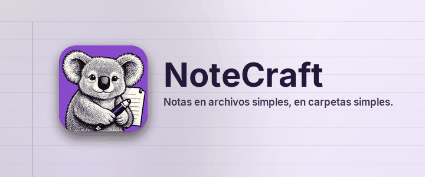

# Bienvenida

*Notas en archivos simples, en carpetas simples.*

NoteCraft guarda las notas como tú guardas los archivos: un cuaderno es una carpeta, una
sección es una carpeta, una página es una carpeta con un archivo y sus imágenes dentro. Nada
queda encerrado en una base de datos, así que cualquier carpeta que tu herramienta de
sincronización ya vigila se convierte en un cuaderno sincronizado, y una copia de seguridad es
una copia.

## Qué puedes hacer aquí

Cada página de esta sección muestra una parte de NoteCraft en la propia página:

- [Escribir una página](../write-a-page/): títulos, listas, negrita, enlaces, ecuaciones, teclas.
- [Etiquetar una línea](../tag-a-line/): casillas de tareas y las demás marcas.
- [Imágenes y archivos](../pictures-and-files/): suelta un archivo sobre la página.
- [Dos formatos de página](../page-formats/): HTML o Markdown, tú eliges.
- [Sincronizar y copias de seguridad](../sync-and-backup/): pon la carpeta donde mira tu herramienta.
- [Hazlo tuyo](../make-it-yours/): 14 temas y nueve colores.
- [De derecha a izquierda](../right-to-left/): árabe, hebreo, persa y urdu.

## Pruébalo ahora

Haz clic en cualquier parte de este párrafo y escribe. La página se guarda sola un segundo
después de que pares. Pulsa **Enter** al final de la línea para un párrafo nuevo y **Escape**
para salir de ella.

Volver a [la página de inicio](../../../00-start/welcome/).

*Esta página la tradujo un modelo de inteligencia artificial. Las correcciones son bienvenidas.*
