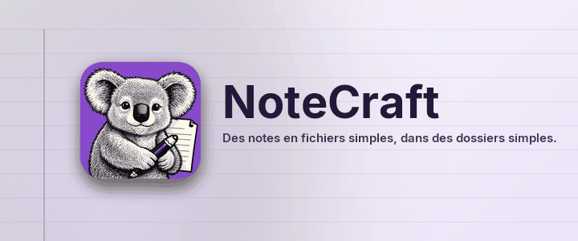

*Des notes en fichiers simples, dans des dossiers simples.*

NoteCraft garde les notes comme vous gardez vos fichiers : un carnet est un dossier, une
section est un dossier, une page est un dossier avec un fichier et ses images dedans. Rien
n'est enfermé dans une base de données, donc n'importe quel dossier que votre outil de
synchronisation surveille déjà devient un carnet synchronisé, et une sauvegarde est une copie.

## Ce que vous pouvez faire ici

Chaque page de cette section montre une partie de NoteCraft, sur la page elle-même :

- [Écrire une page](../write-a-page/) : titres, listes, gras, liens, équations, touches.
- [Étiqueter une ligne](../tag-a-line/) : cases à cocher et autres marques.
- [Images et fichiers](../pictures-and-files/) : déposez un fichier sur la page.
- [Deux formats de page](../page-formats/) : HTML ou Markdown, à vous de choisir.
- [Synchronisation et sauvegarde](../sync-and-backup/) : mettez le dossier là où votre outil regarde.
- [À votre goût](../make-it-yours/) : 14 thèmes et neuf couleurs.
- [De droite à gauche](../right-to-left/) : arabe, hébreu, persan et ourdou.

## Essayez maintenant

Cliquez n'importe où dans ce paragraphe et tapez. La page s'enregistre toute seule environ une
seconde après que vous vous êtes arrêté. Appuyez sur **Entrée** en fin de ligne pour un nouveau
paragraphe, et sur **Échap** pour en sortir.

Retour à [la page de départ](../../../00-start/welcome/).

*Cette page a été traduite par un modèle d'intelligence artificielle. Les corrections sont les bienvenues.*
