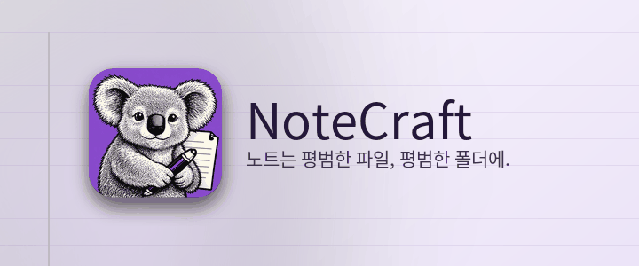

# 환영합니다

*노트는 평범한 파일, 평범한 폴더에.*

NoteCraft는 여러분이 파일을 보관하듯 노트를 보관합니다. 노트북은 폴더이고, 섹션도 폴더이고, 페이지는 파일 하나와 그 그림들이 들어 있는 폴더입니다. 데이터베이스에 갇힌 것은 아무것도 없으므로, 동기화 도구가 이미 지켜보는 폴더라면 무엇이든 동기화된 노트북이 되고, 백업은 복사본 하나로 끝납니다.

## 여기서 할 수 있는 것

이 섹션의 각 페이지는 NoteCraft의 한 부분을 페이지 위에서 직접 보여 줍니다.

- [페이지 쓰기](../write-a-page/): 제목, 목록, 굵게, 링크, 수식, 단축키.
- [줄에 태그 달기](../tag-a-line/): 할 일 상자와 다른 표시들.
- [그림과 파일](../pictures-and-files/): 페이지에 파일을 끌어다 놓기.
- [두 가지 페이지 형식](../page-formats/): HTML 또는 Markdown, 원하는 대로.
- [동기화와 백업](../sync-and-backup/): 동기화 도구가 보는 곳에 폴더 두기.
- [내 취향대로](../make-it-yours/): 14가지 테마와 아홉 가지 색.
- [오른쪽에서 왼쪽으로](../right-to-left/): 아랍어, 히브리어, 페르시아어, 우르두어.

## 지금 해 보기

이 문단 아무 곳이나 클릭하고 입력하세요. 입력을 멈춘 뒤 약 1초 만에 페이지가 저장됩니다. 줄 끝에서 **Enter**를 누르면 새 문단, **Escape**를 누르면 줄에서 나갑니다.

[시작 페이지](../../../00-start/welcome/)로 돌아가기.

*이 페이지는 AI 모델이 번역했습니다. 수정 제안을 환영합니다.*
