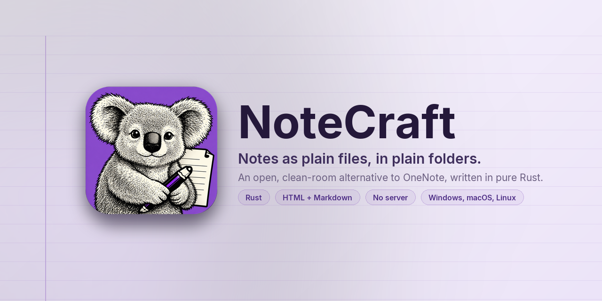

**Notes as plain files, in plain folders.**

This notebook is NoteCraft showing itself. Every page in it is an ordinary page: open it, change it, delete it.

## How it is organised

The notebook has one section group per language. Each group holds a section called "How to" with the same short pages: writing, tags, pictures and files, the two page formats, sync, themes, and right to left. Click a language to open its first page.

- [English](../../10-en/)
- [Español](../../11-es/), Spanish
- [Français](../../12-fr/), French
- [Deutsch](../../13-de/), German
- [हिन्दी](../../14-hi/), Hindi
- [Русский](../../15-ru/), Russian
- [中文（简体）](../../16-zh/), Chinese, Simplified
- [日本語](../../17-ja/), Japanese
- [한국어](../../18-ko/), Korean
- [العربية](../../20-ar/), Arabic, right to left
- [فارسی](../../21-fa/), Persian, right to left
- [اردو](../../22-ur/), Urdu, right to left
- [עברית](../../23-he/), Hebrew, right to left

The pages for a language are written in that language. The ones for Arabic, Persian, Urdu and Hebrew are also written **right to left**, so they show the direction controls on real text.

## Where this notebook lives

Like every notebook, it is a folder on your disk. Look at the bottom right of the window for the notebooks folder, or right-click a row in the tree and choose **Open folder**. The structure you see there is the structure you see here: a folder per group, a folder per section, a folder per page with its file and its pictures inside.

## Who wrote it

The English pages were written by hand from NoteCraft's own guides. The other languages were drafted by an AI model and are marked as such on each page until a native reader has gone over them. Corrections are welcome in the project's issue tracker.
