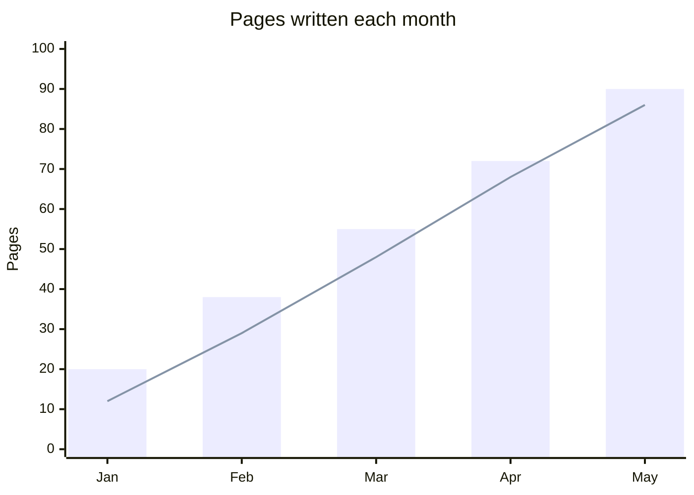
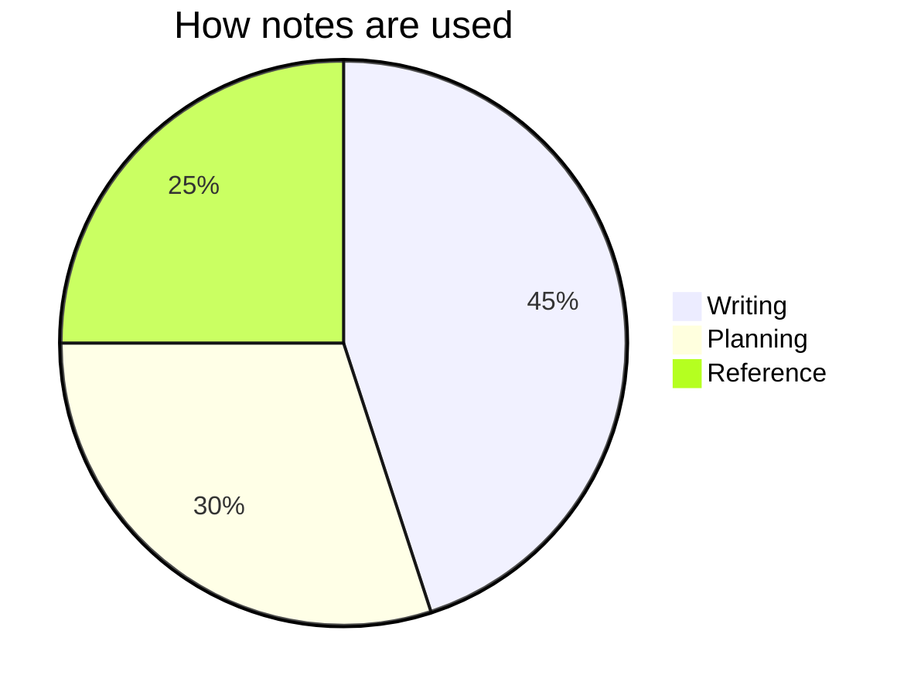
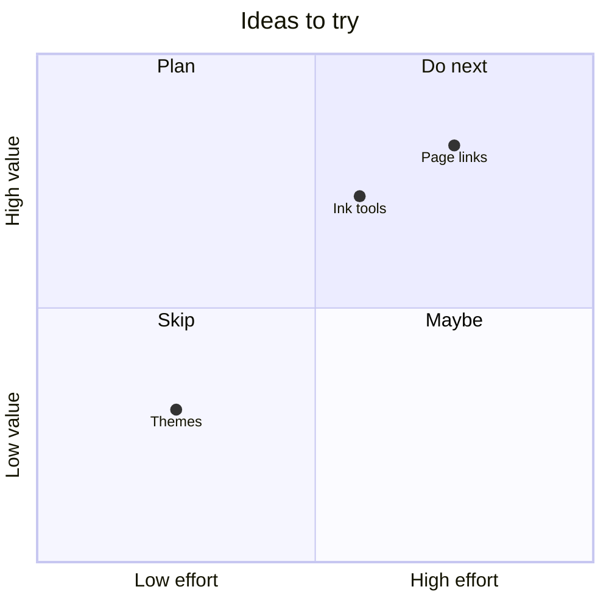
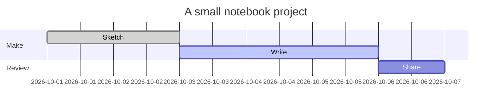

NoteCraft draws Mermaid chart blocks directly on the page. The examples below are rendered
charts. Vega specifications and D3 programs are also useful ways to describe charts, but NoteCraft
currently keeps those as code; it does not execute or render them as charts.

## Rendered charts

### Bars and a line



### A pie



### A quadrant



### A schedule



## Vega source: a bar chart

This specification is shown as JSON source, not drawn by NoteCraft yet.

```json
{
  "$schema": "https://vega.github.io/schema/vega-lite/v5.json",
  "data": {
    "values": [
      {"month": "Jan", "pages": 20},
      {"month": "Feb", "pages": 38},
      {"month": "Mar", "pages": 55}
    ]
  },
  "mark": "bar",
  "encoding": {
    "x": {"field": "month", "type": "ordinal"},
    "y": {"field": "pages", "type": "quantitative"}
  }
}
```

## Vega source: a line chart

```json
{
  "$schema": "https://vega.github.io/schema/vega-lite/v5.json",
  "data": {
    "values": [
      {"month": "Jan", "pages": 12},
      {"month": "Feb", "pages": 29},
      {"month": "Mar", "pages": 48}
    ]
  },
  "mark": "line",
  "encoding": {
    "x": {"field": "month", "type": "ordinal"},
    "y": {"field": "pages", "type": "quantitative"}
  }
}
```

## D3 source: a bar chart

This JavaScript is source code for a D3 chart. NoteCraft displays the code but does not run it.

```javascript
const data = [
  { month: "Jan", pages: 20 },
  { month: "Feb", pages: 38 },
  { month: "Mar", pages: 55 }
];

const svg = d3.select("svg")
  .attr("width", 400)
  .attr("height", 260);
const x = d3.scaleBand()
  .domain(data.map(d => d.month))
  .range([0, 360])
  .padding(0.15);
const y = d3.scaleLinear()
  .domain([0, d3.max(data, d => d.pages)])
  .range([220, 0]);

svg.selectAll("rect")
  .data(data)
  .join("rect")
  .attr("x", d => x(d.month))
  .attr("y", d => y(d.pages))
  .attr("width", x.bandwidth())
  .attr("height", d => 220 - y(d.pages));
```

## D3 source: a line chart

```javascript
const data = [
  { month: "Jan", pages: 12 },
  { month: "Feb", pages: 29 },
  { month: "Mar", pages: 48 }
];

const svg = d3.select("svg")
  .attr("width", 400)
  .attr("height", 260);
const x = d3.scalePoint()
  .domain(data.map(d => d.month))
  .range([20, 360]);
const y = d3.scaleLinear()
  .domain([0, d3.max(data, d => d.pages)])
  .range([220, 0]);
const line = d3.line()
  .x(d => x(d.month))
  .y(d => y(d.pages));

svg.append("path")
  .datum(data)
  .attr("fill", "none")
  .attr("stroke", "currentColor")
  .attr("d", line);
```

Use the rendered Mermaid blocks to see charts in the page. Keep Vega and D3 examples as code
until NoteCraft adds support for those formats.

Next: [Right to left](../right-to-left/).
