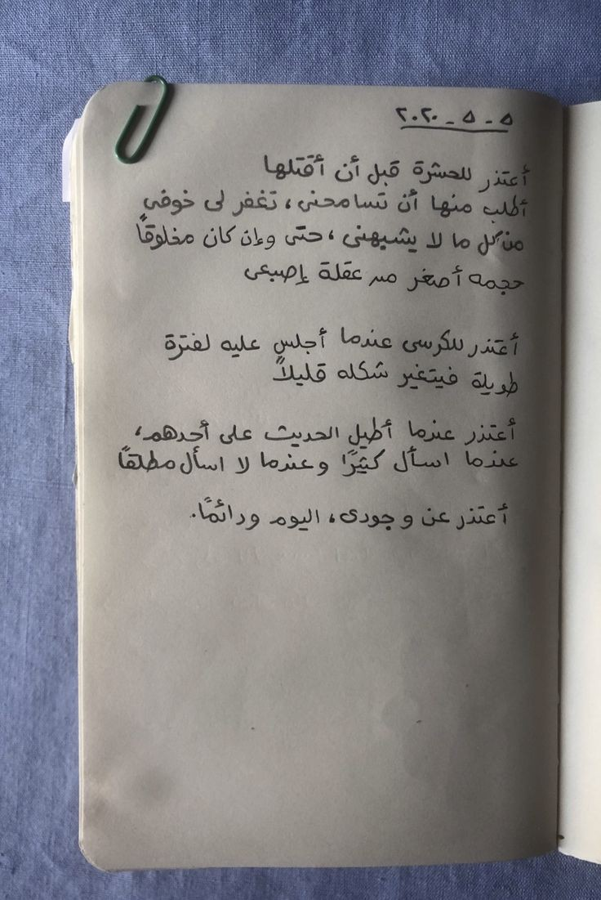

*Draft translation: please check it with a native speaker before release.*

Esta página es parte de la demostración de OCR. Estado: **etapa 2, sin construir**.

La escritura a mano es más difícil que la impresa. Las líneas escritas con cuidado podrán leerse más adelante, una línea cada vez. Una página entera escrita a mano, con tachaduras, todavía no se lee, y el MVP no lo intenta.

Cuando se lee una línea escrita a mano, una palabra tachada se conserva como tachada, no como texto normal. Eso está previsto, pero no construido.

Una página escrita a mano en árabe de un conjunto de datos de dominio público. Se ven las palabras, pero la escritura a mano todavía no se lee; es una etapa posterior.
