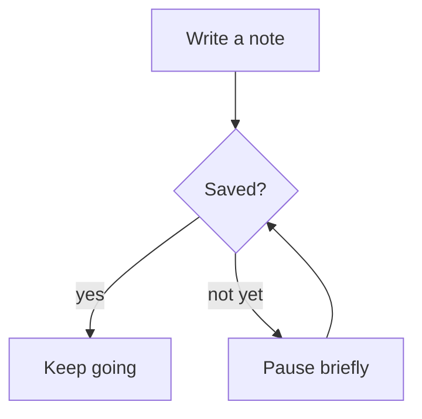
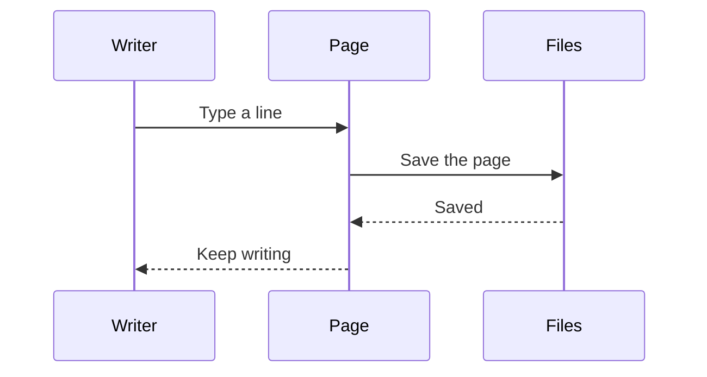
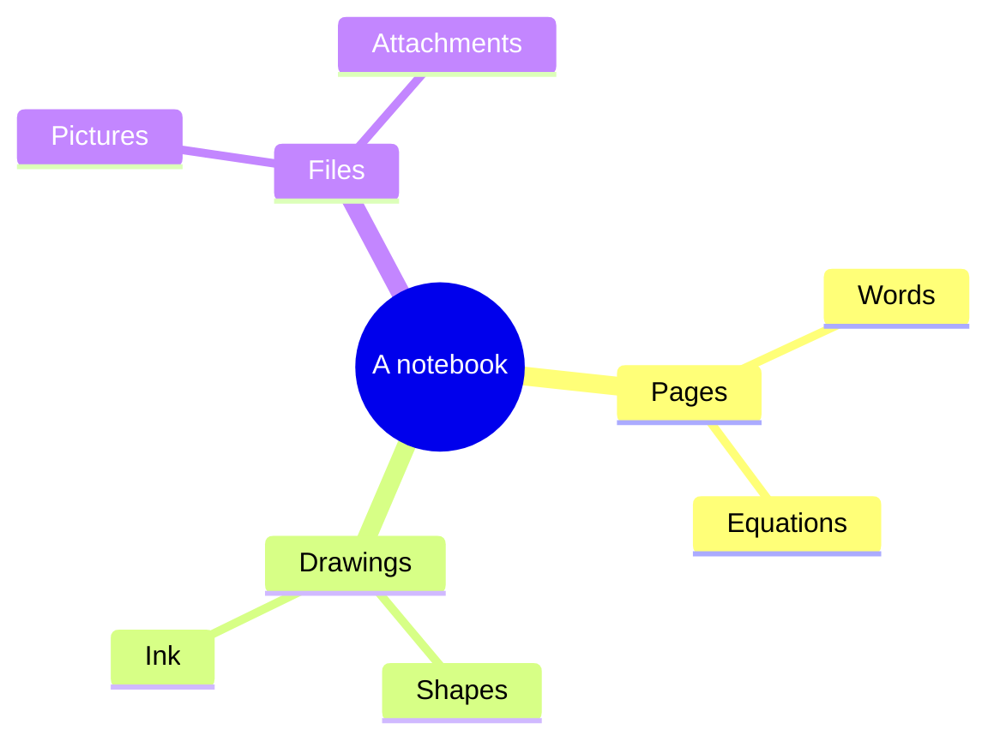
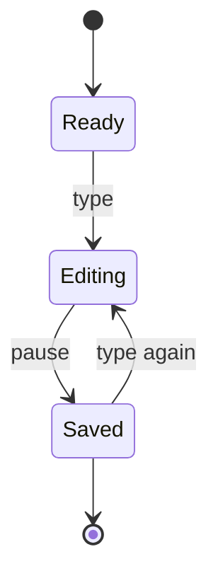
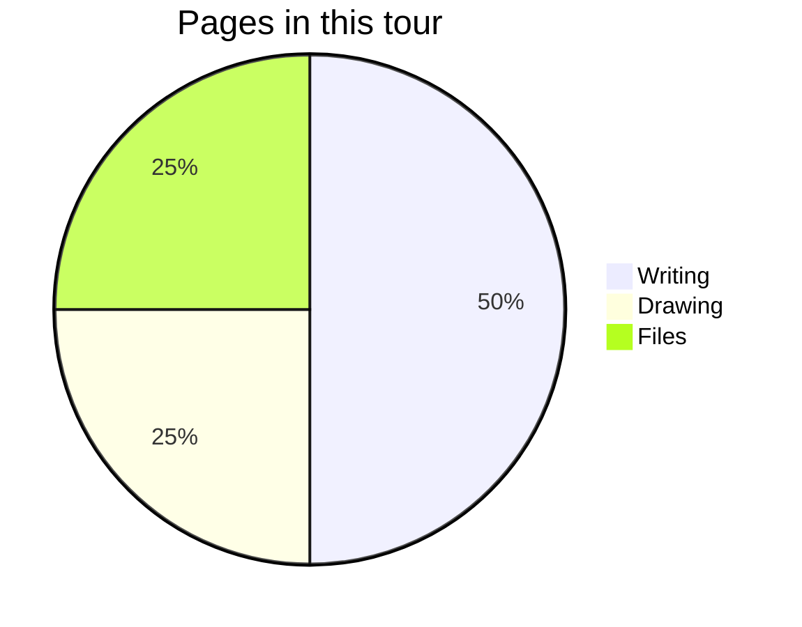

Write a diagram as Mermaid text in a fenced block. NoteCraft draws the block on the page in the
current theme; open the page source with **< >** to edit the text.

## Flowchart

## Sequence

## Mind map

## State diagram

## Pie diagram

Each block is its own diagram. The text stays in the page file, so it can be changed or copied
without an image editor.

Next: [Charts, Vega and D3](../charts-vega-d3/).
