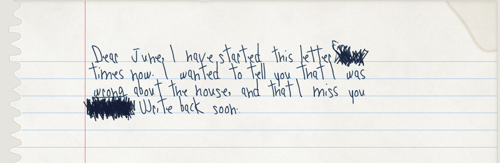

*Draft translation: please check it with a native speaker before release.*

Cette page fait partie de la démonstration OCR. Statut : **étape 2, pas encore construite**. C'est le cas difficile pour la reconnaissance : écriture cursive, pas imprimée.

Source : la page d'écriture de if-this-finds-you (MIT, voir son SOURCE.md). Pas encore lue.
