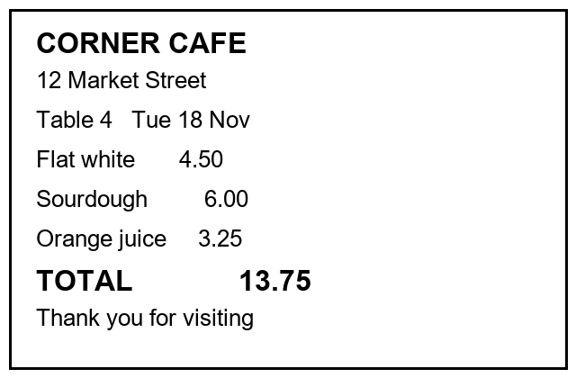

*Draft translation: please check it with a native speaker before release.*

Diese Seite gehört zur OCR-Demo. Status: **MVP**.

Hier ist das Foto eines Kassenbons. NoteCraft liest jede Zeile und hält den Text neben dem Bild. Suche nach einem Preis oder Artikel, und die Seite mit diesem Bon wird gefunden.

Der Text wird aus dem Bild abgeleitet. Ändert sich das Bild, wird der Text neu gelesen; ändert es sich nicht, wird nichts gelesen.
