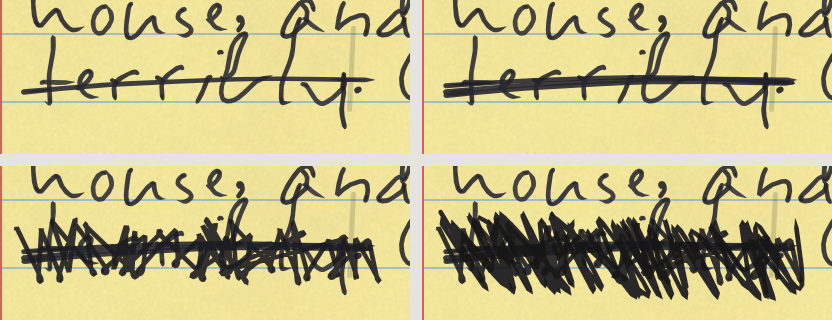

*Draft translation: please check it with a native speaker before release.*

यह पेज OCR डेमो का हिस्सा है। स्थिति: **चरण 2, अभी नहीं बना**। शब्द terribly चार चरणों में काटा गया है। कटा हुआ पाठ खोजने योग्य हो या नहीं, यह खुला प्रश्न है; MVP इसे सामान्य पाठ की तरह रखता है।

स्रोत: if-this-finds-you का लेखन पेज (MIT)। इस पेज पर श्रेय दिया गया है।
