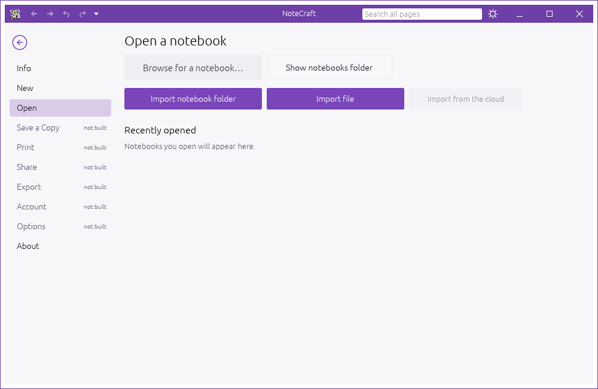
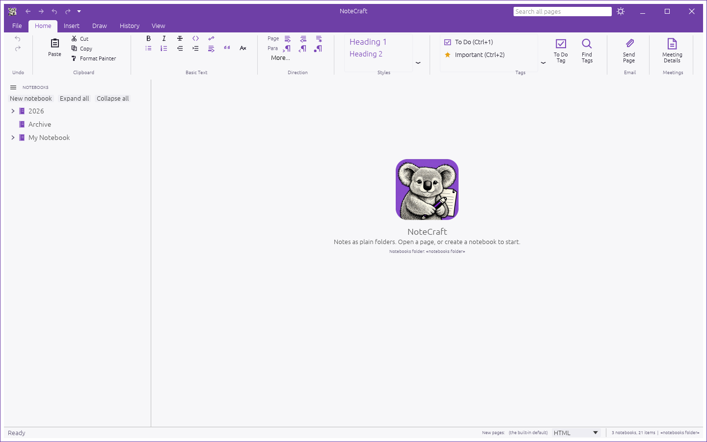
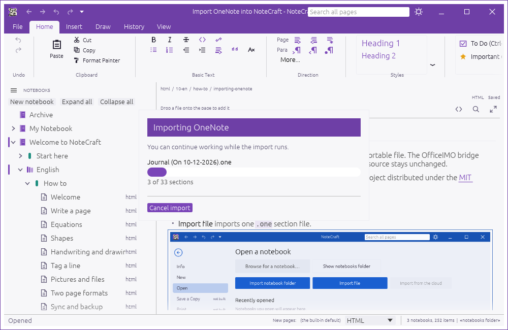

This guide explains importing a complete notebook folder or one importable file. The source stays unchanged.

OneNote 解析由 [OfficeIMO](https://github.com/EvotecIT/OfficeIMO) 提供，这是一个采用 [MIT 许可证](https://github.com/EvotecIT/OfficeIMO/blob/master/LICENSE) 发布的开源项目。

## Import notebook folder

Choose **Import notebook folder** and select a folder such as `2026`. Its name becomes the notebook name. Nested folders become section groups and `.one` files become sections.

## Import file

Choose **Import file** and select one `.one` file. NoteCraft creates a notebook named after the file.

## What happens during import

NoteCraft creates the destination inside the configured notebooks folder, opens the imported notebook after a successful import, and adds it to Recently opened. The original OneNote files are never changed. A progress dialog shows the current section and lets you cancel safely.

If a notebook with the same name already exists, NoteCraft avoids overwriting it by adding a Windows-style suffix: `2026`, `2026 (1)`, `2026 (2)`, and so on.

Folder imports recurse through nested folders. Folders become section groups, `.one` files become sections, and pages and nested pages keep their names and hierarchy.

While an import is running, NoteCraft shows one themed progress dialog with the current section, progress count, and a Cancel import button.

