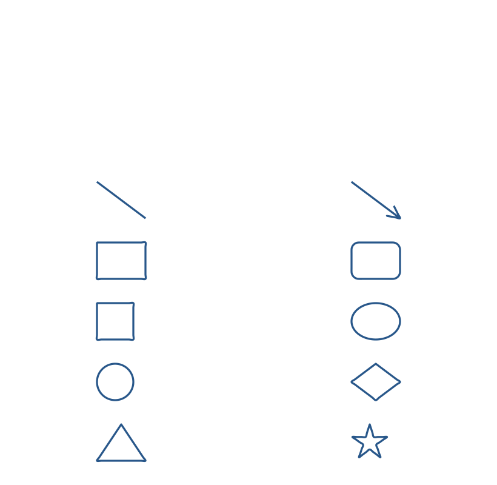

Choose a shape in the **Draw** tab, then drag on the page. Each shape is an editable ink stroke. Select it to move or resize it, or use **Undo stroke** to remove it.

The ten shapes are arranged in the same two-column order as the **Shapes** group.

| Left | Right |
|---|---|
| Line | Arrow |
| Rectangle | Rounded |
| Square | Ellipse |
| Circle | Diamond |
| Triangle | Star |

Next: [Handwriting and drawing](../handwriting-and-drawing/).

