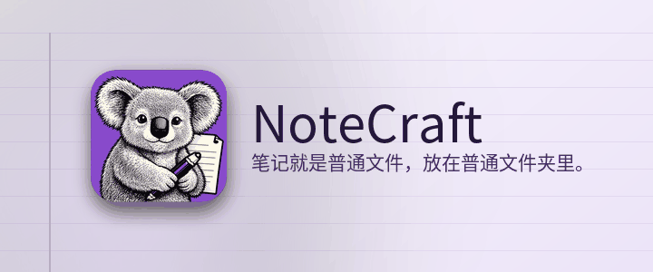

*笔记就是普通文件，放在普通文件夹里。*

NoteCraft 保存笔记的方式和你保存文件一样：笔记本是一个文件夹，分区是一个文件夹，页面是一个文件夹，里面有一个文件和它的图片。没有任何东西锁在数据库里，所以你的同步工具已经在监视的任何文件夹都能变成同步的笔记本，备份就是一份拷贝。

## 在这里你可以做什么

本分区的每一页都在页面上展示 NoteCraft 的一个部分：

- [写一页](../write-a-page/)：标题、列表、粗体、链接、公式、快捷键。
- [给一行加标签](../tag-a-line/)：待办框和其他标记。
- [图片和文件](../pictures-and-files/)：把文件拖到页面上。
- [两种页面格式](../page-formats/)：HTML 或 Markdown，由你选择。
- [同步与备份](../sync-and-backup/)：把文件夹放在同步工具查看的地方。
- [按你的喜好设置](../make-it-yours/)：14 种主题和九种颜色。
- [从右到左](../right-to-left/)：阿拉伯语、希伯来语、波斯语和乌尔都语。
- [形状](../shapes/)：绘图工具支持的全部十种形状。
- [手写与绘图](../handwriting-and-drawing/)：可编辑的墨迹笔画。
- [Mermaid 图表](../mermaid-diagrams/)：多种图表类型。
- [Vega 和 D3 图表](../charts-vega-d3/)：渲染图表与代码示例。

## 现在试试

点击这一段的任何位置然后输入。你停下来大约一秒后，页面会自动保存。在行尾按 **Enter** 开始新段落，按 **Escape** 离开。

回到[起始页](../../../00-start/welcome/)。

*本页由人工智能模型翻译。欢迎指正。*
