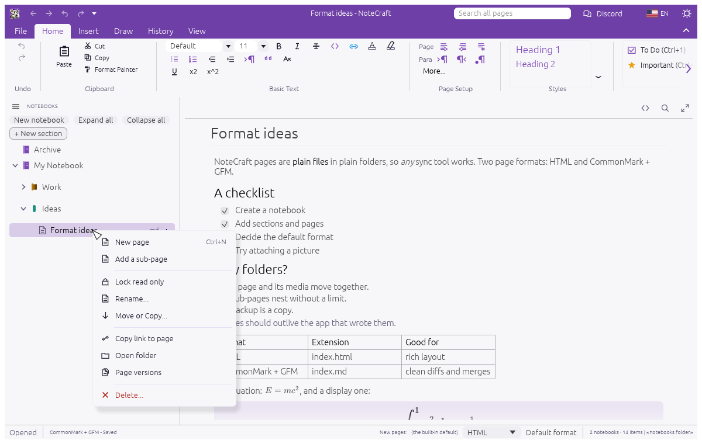

右クリックでは次にできることが表示されます。項目はクリックした場所によって変わります。キーボードのショートカットを使えば、マウスを使わずにページを移動できます。

| 右クリックする場所 | メニューに表示される内容 |
|---|---|
| ナビゲーターのページ | 新しいページ、サブページの追加、読み取り専用にロックまたはロック解除、名前の変更、移動またはコピー、ページへのリンクをコピー、フォルダーを開く、ページのバージョン、削除 |
| ページの本文 | 貼り付け、切り取り、コピー、挿入（表、リンク、数式、日付と時刻、画像、ファイル）、読み取り専用にロックまたはロック解除。ロックされたページはロック解除のみ表示 |
| ページ一覧の空白 | 新しいページと、開いているページの読み取り専用にロックまたはロック解除 |
| ナビゲーターの空白 | 新しいノートブック、フォルダーを開く、ノートブックのフォルダーを表示、開いているページの読み取り専用にロックまたはロック解除 |

## ページをロックする

「読み取り専用にロック」は、ロックをページ自体の中に保存します。そのため、ページのフォルダーをコピーしたり同期したりしても、ロックはページと一緒に移動します。ロックされたページはタイトルと本文を保持します。タイトル欄には入力できず、編集は拒否されます。同じメニューで「ロック解除」を選ぶと、再び編集できます。

## 移動

- Ctrl+Page Up と Ctrl+Page Down: ページ一覧で上または下のページに移動します。
- Alt+左 と Alt+右、またはマウスの戻る・進むボタン: 開いたページの間を戻ったり進んだりします。
- すべてのページを検索: 右上の入力欄で、すべてのページから言葉を探せます。Enter で選んだ結果を開きます。

次：[右から左へ](../right-to-left/)。
