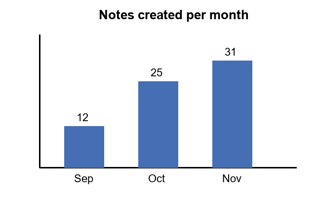

*Draft translation: please check it with a native speaker before release.*

이 페이지는 OCR 데모의 일부입니다. 상태: 차트는 **MVP**이며, 스케치는 이후 단계입니다.

막대 차트는 숫자를 그림 안에 담고 있습니다. NoteCraft는 제목이나 레이블처럼 읽을 수 있는 단어를 읽습니다. 막대는 아직 숫자로 읽지 않습니다.

손으로 그린 스케치는 더 어렵습니다. 그 안의 단어는 읽을 수 있을지 모르지만, 상자와 화살표는 아직 이해하지 못합니다.

