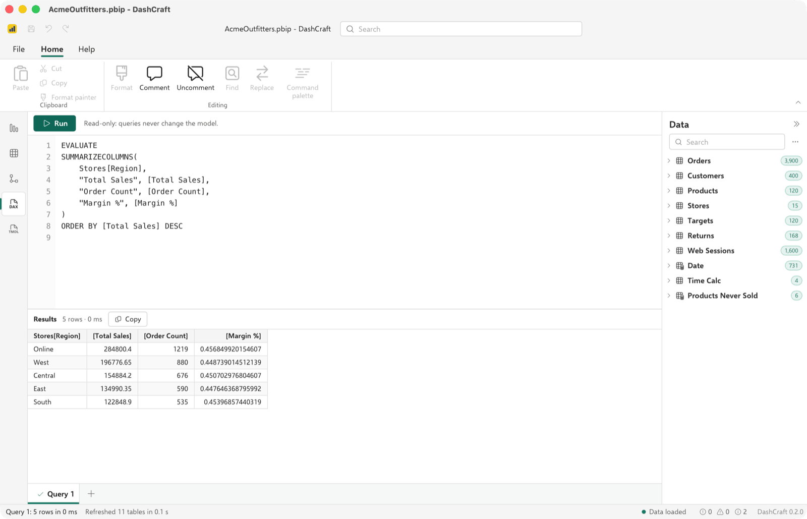

*Draft translation: please check it with a native speaker before release.*

이 페이지는 OCR 데모의 일부입니다. 상태: **MVP**.

앱의 화면 캡처도 텍스트입니다. 여기서는 쿼리 편집기를 줄 단위로 읽으므로, 열 이름이나 측정값 이름으로 검색하면 이 페이지를 찾을 수 있습니다.

표는 텍스트 줄로 읽힙니다. 셀은 검색으로 찾을 수 있지만 표의 구조는 아직 보존되지 않습니다.

출처: DashCraft 프로젝트의 화면 캡처이며, MIT 또는 Apache-2.0 라이선스를 따릅니다. 데이터는 가상입니다.
