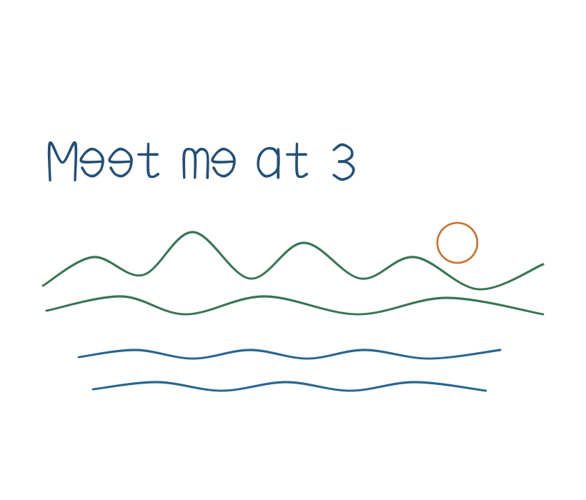

Kalem çizgileri sayfada mürekkep olarak kalır. Kısa bir not yazın, sonra yanına bir eskiz çizin.
Bir çizgiyi taşımak ya da boyutunu değiştirmek için **Seç**'i, birkaç çizgiyi birden almak için **Kement
seçimi**'ni, son işareti geri almak için **Çizgiyi geri al**'ı kullanın.

Bu not ve eskiz kalemle çizildi. Yazılmış harfler ya da düz bir resim değil, düzenlenebilir çizgilerdir.

Geri: [Şekiller](../shapes/).

*Bu sayfa bir yapay zekâ modeli tarafından çevrildi. Düzeltmeler memnuniyetle karşılanır.*

