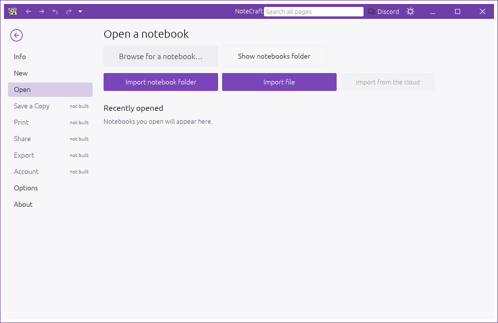
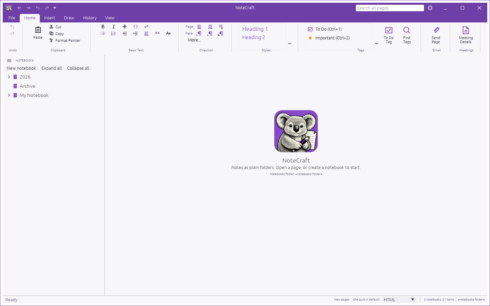
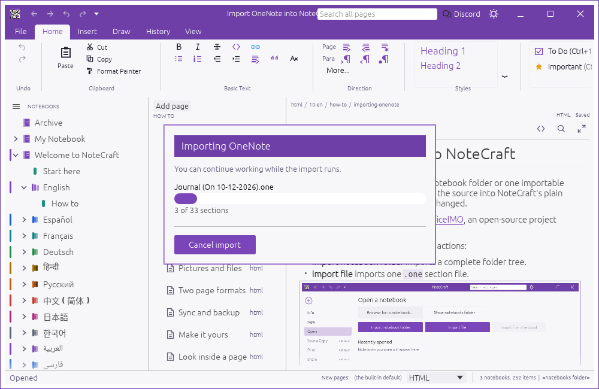

NoteCraft tam bir defter klasörünü ya da aktarılabilir tek bir dosyayı içe aktarabilir. OfficeIMO köprüsü
kaynağı NoteCraft'ın düz klasör biçimine dönüştürür. Kaynak değişmeden kalır.

OneNote ayrıştırması, [MIT lisansı](https://github.com/EvotecIT/OfficeIMO/blob/master/LICENSE) altında
dağıtılan açık kaynaklı bir proje olan [OfficeIMO](https://github.com/EvotecIT/OfficeIMO) tarafından sağlanır.

**Dosya > Aç**'ta iki içe aktarma eylemini kullanın:

- **Defter klasörünü içe aktar** tam bir klasör ağacını içe aktarır.
- **Dosyayı içe aktar** tek bir `.one` bölüm dosyasını içe aktarır.

## Defter klasörünü içe aktarma

**Defter klasörünü içe aktar**'ı seçin ve `2026` gibi bir klasör seçin. Klasör adı defterin adı olur. İç içe
klasörler bölüm gruplarına, `.one` dosyaları ise bölümlere dönüşür. Sayfalar ve iç içe sayfalar adlarını ve
hiyerarşilerini korur.

## Dosyayı içe aktarma

**Dosyayı içe aktar**'ı seçin ve tek bir `.one` dosyası seçin. NoteCraft, dosyanın adını taşıyan bir defter
oluşturur ve içe aktarılan bölümü onun içine koyar.

## İçe aktarma sırasında olanlar

NoteCraft, yapılandırılmış defterler klasörünün içinde hedefi oluşturur, başarılı bir içe aktarmadan sonra
içe aktarılan defteri açar ve **Son açılanlar**'a ekler. Özgün OneNote dosyaları asla değiştirilmez. Bir ilerleme
penceresi geçerli bölümü gösterir ve güvenle iptal etmenize izin verir.

Aynı adda bir defter zaten varsa, NoteCraft Windows tarzı bir sonek ekleyerek üzerine yazmaktan kaçınır:
`2026`, `2026 (1)`, `2026 (2)` ve benzeri.

Klasör içe aktarmaları iç içe klasörlerin içinde ilerler. Klasörler bölüm gruplarına, `.one` dosyaları bölümlere
dönüşür; sayfalar ve iç içe sayfalar adlarını ve hiyerarşilerini korur.

Bir içe aktarma çalışırken NoteCraft, geçerli bölümü, ilerleme sayısını ve bir İçe aktarmayı iptal et düğmesini
gösteren tek bir temalı ilerleme penceresi gösterir.

Şifreli ya da desteklenmeyen bölümler, içe aktarılan defterin `import-errors.txt` dosyasında bildirilir. Bir
klasör okunabilir ve desteklenmeyen dosyaların karışımını içerdiğinde, okunabilir bölümler yine de açılır.

*Bu sayfa bir yapay zekâ modeli tarafından çevrildi. Düzeltmeler memnuniyetle karşılanır.*
