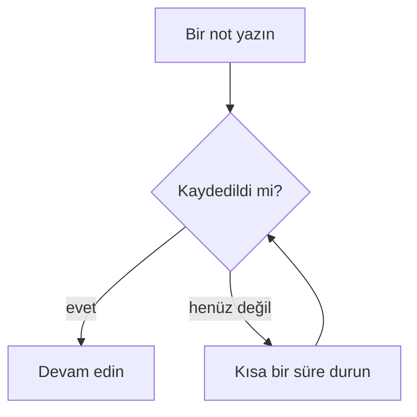
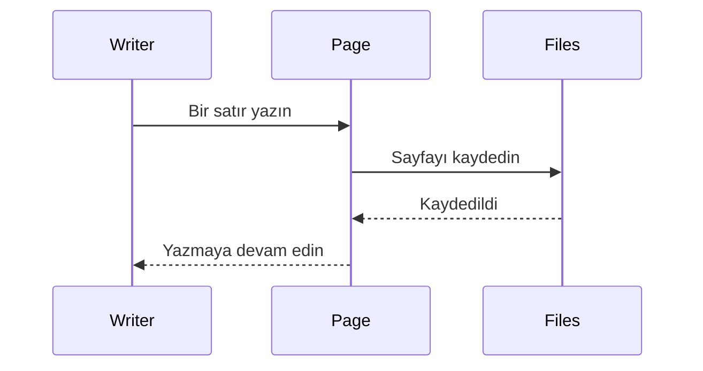
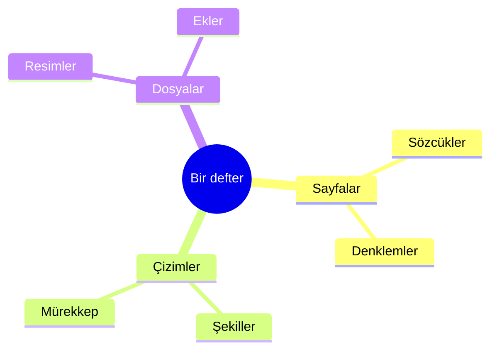
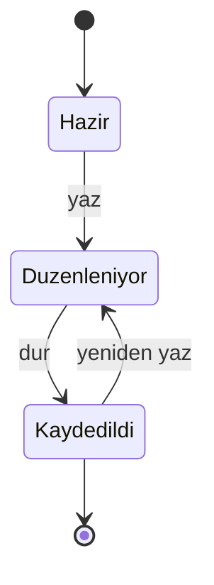
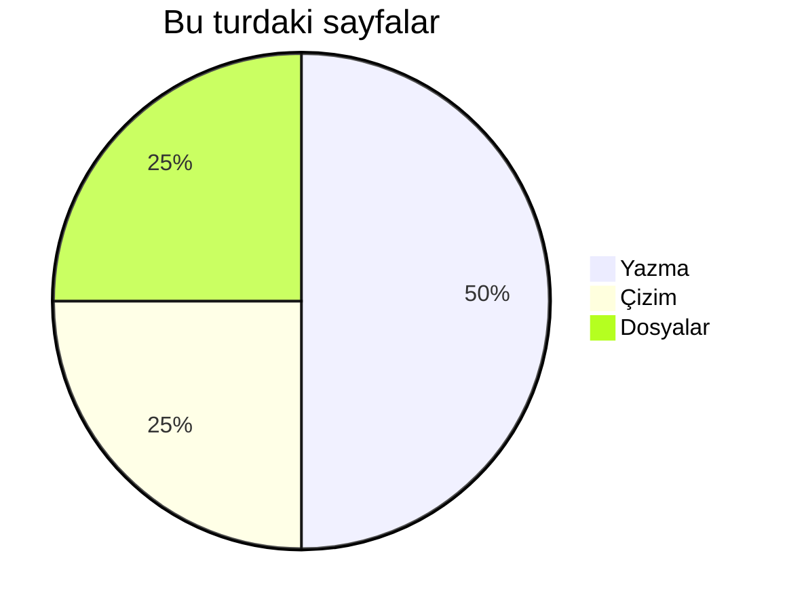

Bir diyagramı, çitli bir blok içinde Mermaid metni olarak yazın. NoteCraft bloğu geçerli temada sayfada
çizer; metni düzenlemek için **< >** ile sayfa kaynağını açın.

## Akış şeması

## Sıra

## Zihin haritası

## Durum diyagramı

## Pasta diyagramı

Her blok kendi diyagramıdır. Metin sayfa dosyasında kalır; bu yüzden bir resim düzenleyicisi olmadan
değiştirilebilir ya da kopyalanabilir.

Sonraki: [Grafikler, Vega ve D3](../charts-vega-d3/).

*Bu sayfa bir yapay zekâ modeli tarafından çevrildi. Düzeltmeler memnuniyetle karşılanır.*
