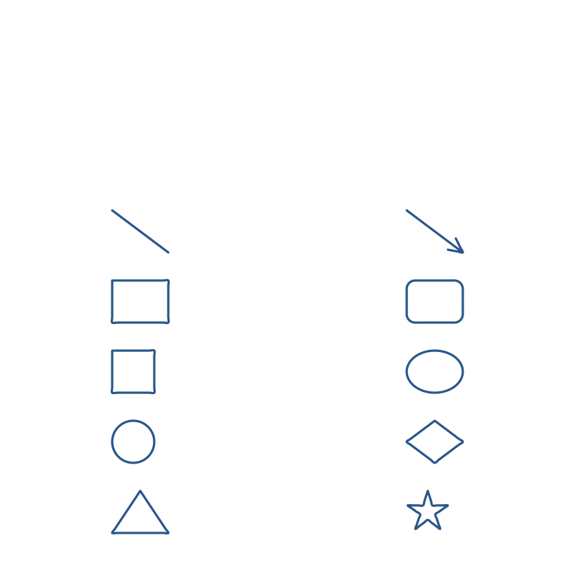

**Çizim** sekmesinde bir şekil seçin, sonra sayfada sürükleyin. Her şekil düzenlenebilir bir mürekkep
çizgisidir. Taşımak ya da boyutunu değiştirmek için seçin, ya da kaldırmak için **Çizgiyi geri al**'ı kullanın.

On şekil, **Şekiller** grubuyla aynı iki sütunlu sırada dizilidir.

| Sol | Sağ |
|---|---|
| Çizgi | Ok |
| Dikdörtgen | Yuvarlak köşeli |
| Kare | Elips |
| Daire | Elmas |
| Üçgen | Yıldız |

Sonraki: [El yazısı ve çizim](../handwriting-and-drawing/).

*Bu sayfa bir yapay zekâ modeli tarafından çevrildi. Düzeltmeler memnuniyetle karşılanır.*

