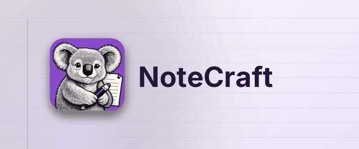

*ملاحظاتك ملفات عادية في مجلدات عادية.*

يحفظ NoteCraft الملاحظات كما تحفظ أنت الملفات: الدفتر مجلد، والقسم مجلد، والصفحة مجلد فيه ملف واحد
وصورها. لا شيء محبوس في قاعدة بيانات، فأي مجلد تراقبه أداة المزامنة عندك يصبح دفترا متزامنا،
والنسخة الاحتياطية مجرد نسخة.

## ما الذي يمكنك فعله هنا

كل صفحة في هذا القسم تعرض جزءا من NoteCraft على الصفحة نفسها:

- [اكتب صفحة](../write-a-page/): العناوين والقوائم والخط العريض والروابط والمعادلات والمفاتيح.
- [ضع وسما على سطر](../tag-a-line/): مربعات المهام والعلامات الأخرى.
- [الصور والملفات](../pictures-and-files/): أفلت ملفا على الصفحة.
- [صيغتان للصفحة](../page-formats/): HTML أو Markdown، كما تختار.
- [المزامنة والنسخ الاحتياطي](../sync-and-backup/): ضع المجلد حيث تنظر أداة المزامنة.
- [اجعله لك](../make-it-yours/): 14 سمة وتسعة ألوان.
- [من اليمين إلى اليسار](../right-to-left/): العربية والعبرية والفارسية والأردية.
- [الأشكال](../shapes/): الأشكال العشرة للرسم.
- [الكتابة اليدوية والرسم](../handwriting-and-drawing/): حبر يمكن تعديله.
- [مخططات Mermaid](../mermaid-diagrams/): عدة أنواع من المخططات.
- [الرسوم البيانية وVega وD3](../charts-vega-d3/): رسوم معروضة وأمثلة شيفرة.

## جرب الآن

انقر في أي مكان من هذه الفقرة واكتب. تحفظ الصفحة نفسها بعد نحو ثانية من توقفك. اضغط **Enter**
في نهاية السطر لفقرة جديدة، و**Escape** لمغادرته.

العودة إلى [صفحة البداية](../../../00-start/welcome/).

*ترجم هذه الصفحة نموذج ذكاء اصطناعي. التصحيحات مرحب بها.*
