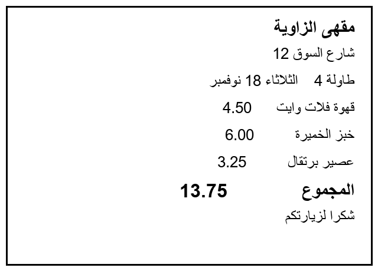

*Draft translation: please check it with a native speaker before release.*

هذه الصفحة جزء من عرض التعرف الضوئي على الحروف. الحالة: **مرحلة لاحقة**.

يُحفظ النص الذي يُكتب من اليمين إلى اليسار بالترتيب الذي يُكتب به. هنا يظهر إيصال عربي: أسعاره تُقرأ بشكل صحيح، لكن الكلمات العربية لا يقرؤها بعد جهاز التعرف في الحد الأدنى للمنتج.

يمكن العثور على الأسطر العربية المطبوعة بالبحث. الملاحظة المكتوبة بخط اليد لا تُقرأ بعد.
