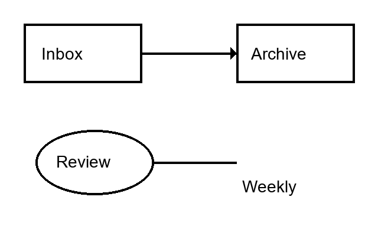

*Draft translation: please check it with a native speaker before release.*

هذه الصفحة جزء من عرض التعرف الضوئي على الحروف. الحالة: المخطط **الحد الأدنى للمنتج**؛ والرسوم اليدوية مرحلة لاحقة.

يحتفظ المخطط العمودي بأرقامه داخل الصورة. يقرأ NoteCraft الكلمات التي يستطيع قراءتها، مثل العنوان والتسميات. ولا تُقرأ الأعمدة أرقاماً بعد.

الرسم اليدوي أصعب. قد تُقرأ كلماته، لكن صناديقه وأسهمه لا تُفهم بعد.

