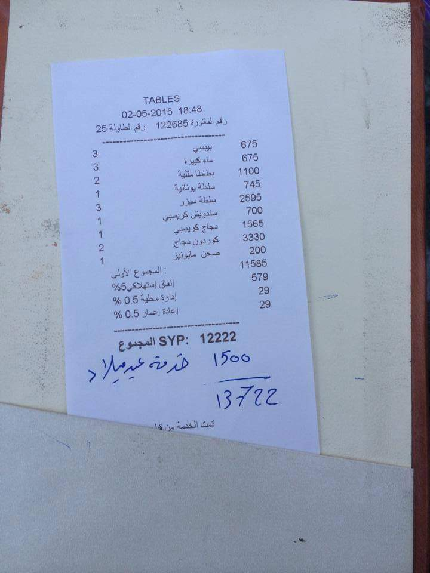

*Draft translation: please check it with a native speaker before release.*

یہ صفحہ OCR ڈیمو کا حصہ ہے۔ حیثیت: **بعد کا مرحلہ**۔

دائیں سے بائیں لکھا ہوا متن اسی ترتیب سے محفوظ رہتا ہے جس میں وہ ٹائپ ہوتا ہے۔ یہاں ایک عربی رسید دکھائی گئی ہے: اس کی قیمتیں درست پڑھی جاتی ہیں، مگر عربی الفاظ کو MVP کا پہچان کنندہ ابھی نہیں پڑھتا۔

چھپی ہوئی عربی سطریں تلاش سے مل جاتی ہیں۔ ہاتھ سے لکھا نوٹ ابھی نہیں پڑھا جاتا۔
