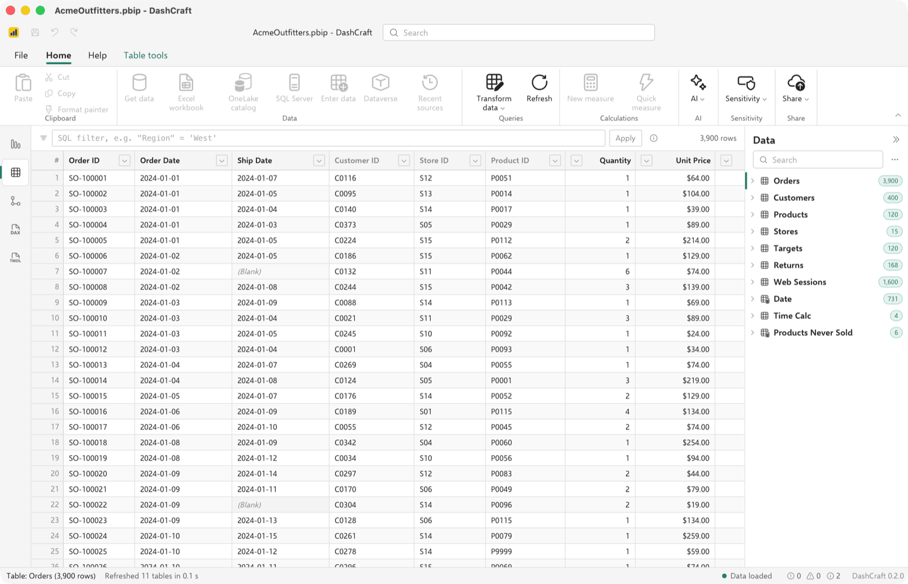

*Draft translation: please check it with a native speaker before release.*

הדף הזה הוא חלק מהדגמת ה-OCR. סטטוס: **MVP**.

צילום מסך של אפליקציה הוא גם טקסט. כאן עורך השאילתות נקרא שורה אחר שורה, ולכן חיפוש של שם עמודה או מדד מוצא את הדף הזה.

טבלה נקראת כשורות טקסט. התאים שלה נמצאים בחיפוש, אבל מבנה הטבלה עדיין לא נשמר.

קרדיט: צילומי מסך מפרויקט DashCraft, לפי הרישיון MIT או Apache-2.0. הנתונים בדויים.
