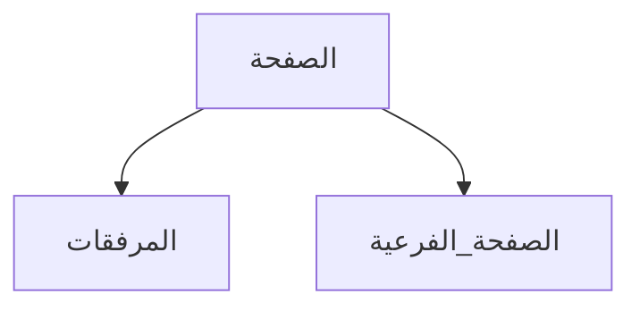

*صفحة فحص: كل ما تستطيع الصفحة حمله، مكتوبا من اليمين إلى اليسار.*

هذه الصفحة ليست شرحا، بل اختبارا بالعين. كل عنصر تعرفه NoteCraft مكتوب هنا بالعربية:
العنوان، والقوائم، والجداول، والشيفرة، والمعادلات، والصور، والرسوم. إن انكسر شيء في
الاتجاه أو في ترتيب الكلمات، فسيظهر هنا قبل أن يظهر في دفتر أحدهم.

## العناوين

### عنوان من المستوى الثالث

نص عادي تحت العنوان، فيه كلمة إنجليزية Markdown ورقم 2026 ونسبة 75% وتاريخ 2026-10-19،
ليرى القارئ أن الأرقام تبقى كما هي داخل سطر عربي.

## القوائم

- عنصر أول
- عنصر فيه **كلمة غليظة** و*كلمة مائلة* و`شيفرة قصيرة`
- عنصر فيه رابط إلى [صفحة الكتابة](../write-a-page/)

1. أولا
2. ثانيا
3. ثالثا، وفيه رقم 123 في آخره

- [x] مهمة منتهية
- [ ] مهمة لم تبدأ

## الوسوم

- TODO: راجع هذه الصفحة بعينَي قارئ عربي
- IMPORTANT: الاتجاه ليس زينة، بل شرط لقراءة السطر

## جدول

| البند | العدد | ملاحظة |
| --- | --- | --- |
| دفاتر | 3 | ثلاثة دفاتر |
| صفحات | 128 | فيها صفحة اسمها Welcome |
| مرفقات | 12 | صور وملفات |

## اقتباس

> الملاحظات يجب أن تعيش أطول من البرنامج الذي كتبها.

## شيفرة

نص داخل سطر: `cargo xtask ci`، ثم كتلة كاملة:

```text
notebook/
  section/
    page/
      index.md
```

## معادلة

معادلة داخل السطر: $E = mc^2$، ومعادلة معروضة:

$$
\int_0^1 x^2\,dx = \tfrac{1}{3}
$$

## رسم



## صورة


## أقواس وعلامات

النص (مثال) هنا، و[قوس معقوف] آخر، و"علامات اقتباس"، وفاصلة منقوطة؛ ونقطة.

---

*آخر سطر في الصفحة: تذييل صغير، يأتي بعد الخط الفاصل.*
