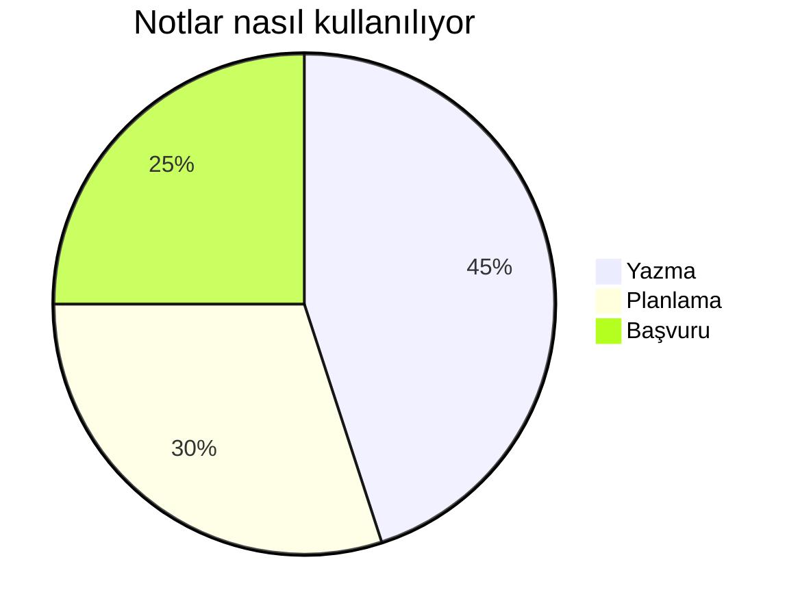
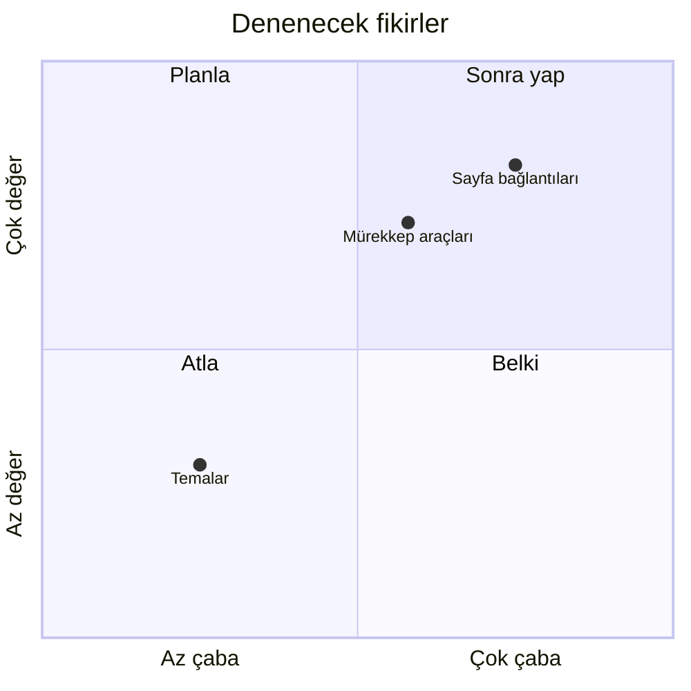
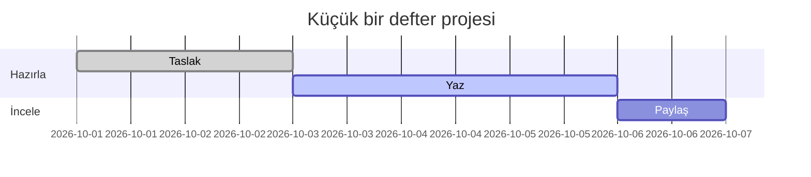

# Grafikler, Vega ve D3

NoteCraft Mermaid grafik bloklarını doğrudan sayfaya çizer. Aşağıdaki örnekler çizilmiş grafiklerdir.
Vega belirtimleri ve D3 programları grafikleri tanımlamanın da yararlı yollarıdır, ancak NoteCraft şu anda
bunları kod olarak tutar; onları çalıştırmaz ya da grafik olarak çizmez.

## Çizilmiş grafikler

### Çubuklar ve bir çizgi

```mermaid
xychart-beta
    title "Ayda yazılan sayfalar"
    x-axis [Oca, Şub, Mar, Nis, May]
    y-axis "Sayfa" 0 --> 100
    bar [20, 38, 55, 72, 90]
    line [12, 29, 48, 68, 86]
```

### Bir pasta



### Bir dörtlü grafik



### Bir takvim



## Vega kaynağı: bir çubuk grafik

Bu belirtim, NoteCraft tarafından henüz çizilmeyen bir JSON kaynağı olarak gösterilir.

```json
{
  "$schema": "https://vega.github.io/schema/vega-lite/v5.json",
  "data": {
    "values": [
      {"month": "Oca", "pages": 20},
      {"month": "Şub", "pages": 38},
      {"month": "Mar", "pages": 55}
    ]
  },
  "mark": "bar",
  "encoding": {
    "x": {"field": "month", "type": "ordinal"},
    "y": {"field": "pages", "type": "quantitative"}
  }
}
```

## Vega kaynağı: bir çizgi grafik

```json
{
  "$schema": "https://vega.github.io/schema/vega-lite/v5.json",
  "data": {
    "values": [
      {"month": "Oca", "pages": 12},
      {"month": "Şub", "pages": 29},
      {"month": "Mar", "pages": 48}
    ]
  },
  "mark": "line",
  "encoding": {
    "x": {"field": "month", "type": "ordinal"},
    "y": {"field": "pages", "type": "quantitative"}
  }
}
```

## D3 kaynağı: bir çubuk grafik

Bu JavaScript bir D3 grafiğinin kaynak kodudur. NoteCraft kodu gösterir ama çalıştırmaz.

```javascript
const data = [
  { month: "Oca", pages: 20 },
  { month: "Şub", pages: 38 },
  { month: "Mar", pages: 55 }
];

const svg = d3.select("svg")
  .attr("width", 400)
  .attr("height", 260);
const x = d3.scaleBand()
  .domain(data.map(d => d.month))
  .range([0, 360])
  .padding(0.15);
const y = d3.scaleLinear()
  .domain([0, d3.max(data, d => d.pages)])
  .range([220, 0]);

svg.selectAll("rect")
  .data(data)
  .join("rect")
  .attr("x", d => x(d.month))
  .attr("y", d => y(d.pages))
  .attr("width", x.bandwidth())
  .attr("height", d => 220 - y(d.pages));
```

## D3 kaynağı: bir çizgi grafik

```javascript
const data = [
  { month: "Oca", pages: 12 },
  { month: "Şub", pages: 29 },
  { month: "Mar", pages: 48 }
];

const svg = d3.select("svg")
  .attr("width", 400)
  .attr("height", 260);
const x = d3.scalePoint()
  .domain(data.map(d => d.month))
  .range([20, 360]);
const y = d3.scaleLinear()
  .domain([0, d3.max(data, d => d.pages)])
  .range([220, 0]);
const line = d3.line()
  .x(d => x(d.month))
  .y(d => y(d.pages));

svg.append("path")
  .datum(data)
  .attr("fill", "none")
  .attr("stroke", "currentColor")
  .attr("d", line);
```

Sayfada grafikleri görmek için çizilmiş Mermaid bloklarına bakın. Vega ve D3 örneklerini, NoteCraft bu
biçimleri desteklemeye başlayana kadar kod olarak tutun.

Sonraki: [Sağdan sola](../right-to-left/).

*Bu sayfa bir yapay zekâ modeli tarafından çevrildi. Düzeltmeler memnuniyetle karşılanır.*
