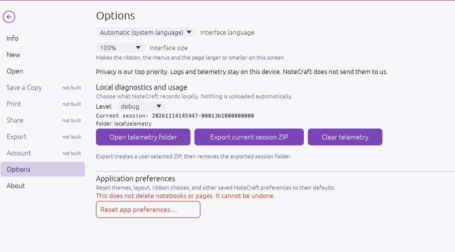

# Capture logs and send feedback

NoteCraft keeps your notes, settings, logs, and telemetry on your device. Nothing is
sent over the network automatically. When you find a bug, a visual fault, or a crash,
you can collect diagnostic logs locally and attach them to an issue or feedback report.

## Choose a diagnostics level

Open **File**, then **Options**. Under **Local diagnostics and usage**, you can see the
current recording level, the active session identifier, and the folder where session
data is stored.



Five levels are available:

| Level | What it records |
|---|---|
| `none` | Records nothing. Default in release builds. |
| `usage` | Records user interface navigation and feature actions. |
| `warning` | Records warnings and usage events. |
| `error` | Records errors, warnings, and usage events. |
| `debug` | Records detailed diagnostic traces across all subsystems. |

To troubleshoot a problem:

1. Open **File**, then **Options**.
2. Set **Level** to `debug`.
3. Return to your notebook and repeat the action that failed.
4. Return to **File** -> **Options** to export the log.

## Export session diagnostics (ZIP)

The **Options** page provides three buttons for session data:

- **Export current session ZIP**: prompts you for a save location and packages the
  active session into a `.zip` file named `notecraft-<session-id>-telemetry.zip`.
  Exporting moves the session data into the archive and removes the exported folder
  from disk.
- **Open telemetry folder**: opens the diagnostics directory in your file manager.
- **Clear telemetry**: deletes existing local session folders when you want to free disk
  space.

### What the session archive contains

The exported ZIP archive contains two files:

- `manifest.json`: records the schema version, session identifier, logging level, and
  build profile (production or debug).
- `events.jsonl`: records timestamped JSON lines for each event.

File paths recorded in `events.jsonl` are automatically redacted so local directory
names are replaced with `[path]`.

## The application log (notecraft.log)

NoteCraft also writes a plain-text log file named `notecraft.log` in the configuration
directory outside your notebooks:

- Windows: `%APPDATA%\NoteCraft\notecraft.log`
- Linux and macOS: `~/.config/notecraft/notecraft.log`

Each line records the UTC timestamp, log level, and message. Panic backtraces, GPU
initialization errors, and windowing failures are written here. When the file reaches
1 MB, it rotates to `notecraft.log.old`.

If NoteCraft fails to open or closes unexpectedly before you can reach the **Options**
screen, check `notecraft.log` directly. You can also run NoteCraft with debug logging
enabled from your terminal by setting the `RUST_LOG` environment variable:

```sh
RUST_LOG=debug notecraft
```

## How to send actionable feedback

When submitting a bug report or feedback on the project issue tracker
(<https://github.com/AlienTechSoftware/notecraft/issues>):

1. **Steps to reproduce**: list the exact actions that lead to the issue.
2. **Expected behavior**: describe what should have happened.
3. **Observed behavior**: describe what actually happened, including any error message.
4. **Environment**: your operating system, screen scaling, and NoteCraft version (found
   under **File** -> **About**).
5. **Logs**: attach the exported telemetry ZIP or paste relevant lines from
   `notecraft.log`.
