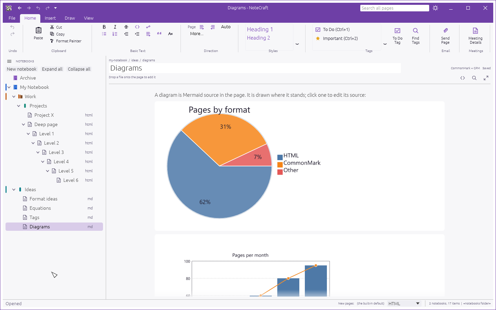

# Draw diagrams and charts

A diagram in NoteCraft is Mermaid source: plain text that says what to draw. The page keeps the
text, and NoteCraft draws it where it stands, in your theme's colours. Nothing is a picture until
you look at it, and nothing is sent anywhere.

## See one, and change it

1. Put a diagram in a page. Insert, then **Diagram**, adds a starter one; or write your own.
2. It is drawn in the page, where it stands. A diagram that cannot be drawn shows its source, and
   says why.
3. **Click the drawing** to put the caret in it. Its source opens to edit, with the drawing still
   above it, and the drawing follows what you type. Click away and it is the drawing again.

The **`< >`** button opens the page's files in the code view, which shows the page's text as it is,
with no drawing: the place to fix a page by hand.

## How a diagram is kept

In either page format, so the same diagram looks the same:

| Page format | The diagram is |
|---|---|
| Markdown | a fenced block: three backticks and `mermaid`, the diagram, three backticks |
| HTML | `<pre class="diagram">` as NoteCraft writes it, or `<pre class="mermaid">` or `
` as Mermaid's own pages do. `<` and `>` are written as `&lt;` and `&gt;`, as in any HTML |

A diagram's source can also be a file of its own in the page's folder, with the name ending `.mmd`
or `.mermaid`. The code view lists it, and you can type in it. The page does not draw a file that
way yet: only a diagram written in the page's own text is drawn.

## What can be drawn

Flowcharts, sequence diagrams, class diagrams, state diagrams, entity-relationship diagrams, Gantt
charts, mind maps, timelines, pie charts, bar and line charts (`xychart-beta`), quadrant charts,
and more: whatever the renderer, `mermaid-rs-renderer`, can read. In the tests, the ones the page
checks are the kinds above. Arabic, Hebrew and mixed labels are drawn joined and in the right
direction, and a right-to-left flowchart runs right to left.

Charts are Mermaid's own: a pie, bars with a line, a quadrant. They are not a general plotting
tool; a Vega-Lite chart from data in a file is planned and not built.

## When it cannot be drawn

- **A mistake in the source.** The page says "Not drawn" and the reason, in one line, above the source,
  and the text is there to fix.
- **Too big.** A diagram of more than 150 lines or 20,000 characters is not drawn, and says so
  at once. A very large graph can take the renderer seconds to lay out.
- **Slow.** Drawing happens off to one side, so the window never waits: you see "Drawing..." and
  then the picture. A diagram that takes more than eight seconds is given up on.
- **Wider than the room.** It is made smaller to fit. A very tall one is kept at its own size, and
  the page scrolls.

A diagram is never lost. Whatever happens, the text is the page's.

## Not built yet

- Drawing a diagram that is kept as a file of its own.
- Saving the drawn picture beside the page, for other programs to show.
- Vega-Lite charts, and other diagram languages.
- Zoom and pan on a large drawing.

The plan, and why the renderer was chosen, are in `docs/gaps.md` and `docs/architecture.md`.
