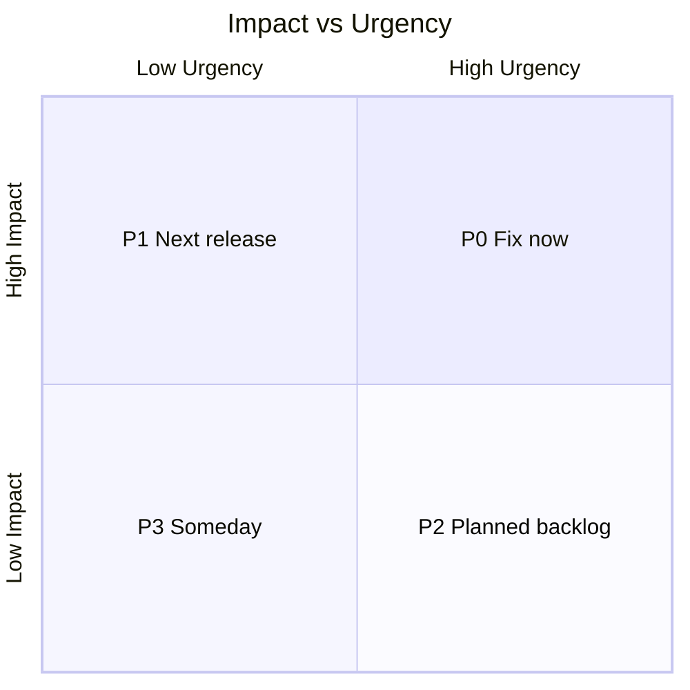
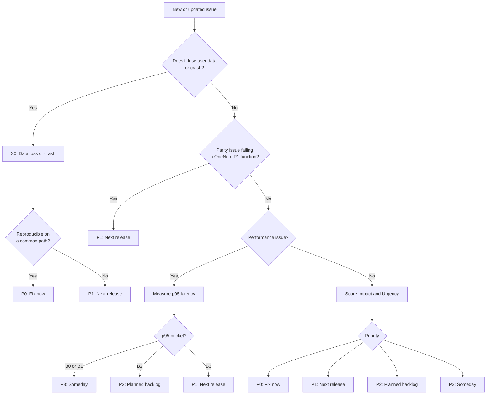
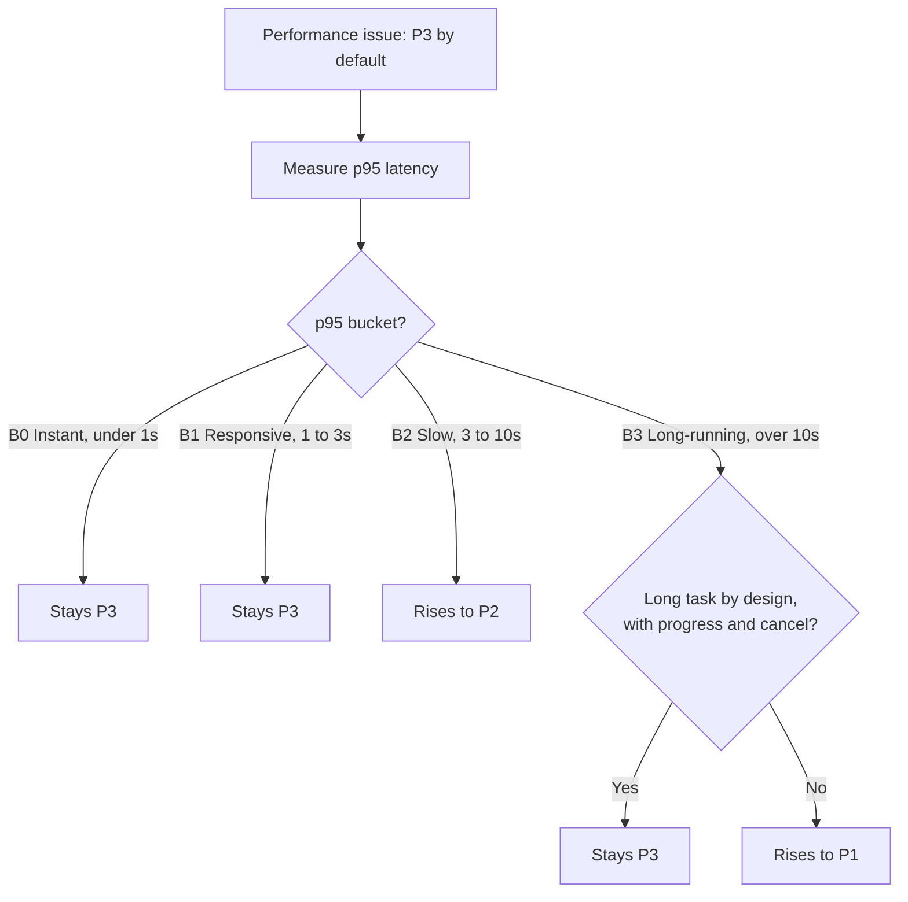

# NoteCraft Issue Prioritization

Status: Draft, for owner review. Not adopted.
Date: 2026-11-17.
Repository: AlienTechSoftware/notecraft.

## 1. Purpose

This document defines how NoteCraft issues are prioritized. It gives every
issue one priority, P0 to P3, derived from two axes: Impact and Urgency.

The system exists so that triage is repeatable. Two people scoring the same
issue should reach the same priority. Where judgment is still required, this
document states the default and names the exception.

## 2. Principles

1. We do not lose people's work. Data loss is the highest severity. Any
   confirmed loss of user content outranks every other consideration except
   a wider data-loss incident.
2. A crash is treated as data loss until proven otherwise. A crash usually
   loses unsaved work, so crashes sit in the same severity group as data
   loss. The burden of proof is on showing that no work was lost.
3. Impact is Severity times Frequency. A severe defect that almost nobody
   hits is not the same as a severe defect on the daily path. Both factors
   are scored.
4. Urgency is time, not importance. A release blocker and a growing wave of
   user reports are urgent. A serious defect with no time pressure is still
   serious, but it is not urgent.
5. Performance is a second-class citizen by default. A slow action that
   still completes is P3 unless measurement shows the experience has
   crossed into a slower latency bucket.
6. Parity is measured against OneNote. A parity gap in a core OneNote
   function is P1, because the function is the reason the user is here.

## 3. The model at a glance

Every issue is scored on Impact and Urgency. Impact comes from Severity and
Frequency. The two axes combine into a single priority.

Reading the chart:

- High Impact and High Urgency is P0. Fix now.
- High Impact and Low Urgency is P1. Next release.
- Low Impact and High Urgency is P2. Planned backlog, ahead of P3.
- Low Impact and Low Urgency is P3. Someday.

Three special rules override the matrix. They are stated in full in
Section 10 and summarized here:

- Data loss and crashes are S0, which forces P0 or P1 regardless of
  frequency.
- A parity issue that fails to reproduce a OneNote P1 function is P1.
- A performance issue is P3 by default. Its measured latency percentile
  can raise it to P2 or P1.

## 4. Severity

Severity measures how bad the outcome is for one affected user. It does not
consider how many users are affected. That is Frequency.

| Level | Name | Definition |
|-------|------|------------|
| S0 | Data loss | User content is lost, damaged, or silently dropped. Includes any crash that loses unsaved work, notebook corruption, lost pages or sections, and import that drops page content. |
| S1 | Unusable | A core task cannot be completed, or the application crashes with no work lost. The user is blocked, but their content is safe. |
| S2 | Broken with workaround | A feature does not work as intended, but the user can still reach the goal another way. |
| S3 | Minor | A cosmetic defect, a small annoyance, or a rough edge that does not block any task. |

Notes on S0:

- S0 is the only severity that overrides Frequency. An S0 issue is High
  Impact at any frequency, including a rare edge case.
- Import that drops content is S0. Content the user believed was imported,
  but was not, is lost work.
- A crash is S0 by default. It drops to S1 only once it is shown that no
  work was lost: the session is recovered cleanly, the crash happens after
  a save, or the crash is in a path that holds no user content.
- Autosave and crash recovery are part of the fix for a crash, not a
  separate feature. A crash the user recovers from cleanly is a lower
  severity than one that loses their work.

Notes on S1:

- S1 covers crashes with no data loss and tasks that cannot be completed
  at all, such as a feature that errors on every use.
- S1 does not cover tasks that are slow. Slowness is scored under
  Section 10.3.

## 5. Frequency

Frequency measures how often the defect is hit. It combines how many users
are affected with how often each affected user hits it.

| Level | Name | Definition |
|-------|------|------------|
| F3 | Daily path | Most users hit it, or it sits on a path used every day, such as typing, saving, or opening a notebook. |
| F2 | Common | Many users hit it, or it is hit regularly by a large group, such as users of one platform or one input method. |
| F1 | Occasional | Hit sometimes, or only in a specific setup, such as one printer model, one language, or one screen size. |
| F0 | Rare | An edge case. Few users, unusual conditions, hard to reproduce. |

Notes:

- Frequency is judged by the affected population, not by the number of
  reports. One report of a defect on the daily path is F3. Ten reports of
  the same rare setup are still F1.
- When Frequency is unknown, score it one level higher than the best
  guess. It is cheaper to over-prioritize a defect than to leave a common
  defect sitting in the backlog.
- Frequency is re-scored when new reports arrive. A defect that turns out
  to be common moves up.

## 6. Impact

Impact is Severity combined with Frequency. It is rated High, Medium, or
Low.

|  | F3 Daily path | F2 Common | F1 Occasional | F0 Rare |
|---|---|---|---|---|
| S0 Data loss | High | High | High | High |
| S1 Unusable | High | High | Medium | Medium |
| S2 Broken with workaround | High | Medium | Medium | Low |
| S3 Minor | Medium | Medium | Low | Low |

Rules:

- S0 is High Impact at every Frequency. Data loss does not become
  acceptable because it is rare.
- S1 on the daily path or a common path is High Impact. A blocked core
  task that many users hit is as urgent as it gets, short of data loss.
- S3 on the daily path is Medium Impact, not High. An annoyance that
  everyone sees still matters, but it does not outrank broken features.

## 7. Urgency

Urgency measures time pressure. It answers one question: what happens if
this waits?

| Level | Name | Definition |
|-------|------|------------|
| U3 | Blocking | Blocks a release, is a regression in the current release, or is a security defect with live exposure. Waiting has a concrete cost now. |
| U2 | Rising | Users are reporting it now, reports are growing, or a deadline depends on it. Waiting makes it worse. |
| U1 | None | No time pressure. The issue has waited this long without getting worse, and waiting longer changes nothing. |

Notes:

- A regression is U3. A feature that worked in the last release and is
  broken now is worse than a feature that never worked, because users
  built habits around it.
- Report volume is evidence for U2, not for Severity. Many reports of a
  minor defect make it urgent, not severe.
- U1 is the default. An issue is U1 unless there is a specific reason it
  is not.

## 8. Priority

Priority is the single ordering. It combines Impact and Urgency, subject to
the special rules in Section 10.

| Priority | Name | Meaning | Response |
|----------|------|---------|----------|
| P0 | Fix now | Drop other work. Fix, verify, and ship as soon as possible. | Same day. Owner notified immediately. |
| P1 | Next release | Fix in the next release. Scheduled work, not interrupt work. | Planned into the next release cycle. |
| P2 | Planned backlog | Fix when scheduled. Ordered ahead of P3. | Triaged into the backlog with a rough milestone. |
| P3 | Someday | Fix when convenient, or accept. No commitment. | Backlog. Re-scored if reports arrive. |

Combination rules:

- High Impact with U3 is P0.
- High Impact with U2 or U1 is P1.
- Medium Impact with U3 is P1.
- Medium Impact with U2 is P2.
- Medium Impact with U1 is P2.
- Low Impact with U3 is P2.
- Low Impact with U2 or U1 is P3.

In short: P0 needs both High Impact and U3, unless a special rule applies.
P1 needs High Impact, or Medium Impact with U3. Everything else is P2 or
P3.

## 9. Triage decision flow

Score issues in this order. The first rule that matches decides the
priority. Do not score Impact and Urgency first and then apply the special
rules; the special rules come first.

## 10. Special rules

### 10.1 Crashes and data loss

Crashes are grouped with data loss in S0.

- A crash is S0 by default, because a crash usually loses unsaved work.
- A crash drops to S1 only once it is shown that no work was lost.
- An S0 issue is at least P1, even if it is rare (F0) and has no time
  pressure (U1). It is P0 when it is reproducible on a common path (F2
  or F3) or when it is blocking (U3).
- The fix for a crash includes autosave and recovery. If the user can
  recover their work after the crash, the severity of future crashes of
  the same kind drops.

### 10.2 Parity issues and OneNote P1 functions

A parity issue that fails to reproduce a OneNote P1 function is P1.

- A P1 function is a core OneNote function: one the user relies on daily
  and would notice immediately if it were missing or broken.
- Proposed P1 function list (open question, Section 13): text editing,
  saving, sync, search, and insert. The owner confirms or replaces this
  list.
- A parity gap in a P1 function is P1 even if the Severity and Frequency
  scores alone would give P2. Parity is the product promise, and a gap in
  a core function breaks that promise directly.
- A parity gap in a function outside the P1 list is scored normally
  through Impact and Urgency. Most such gaps land at P2 or P3.
- A parity issue that also loses data or crashes is scored under
  Section 10.1, not here. Data loss outranks parity.

### 10.3 Performance and latency buckets

Performance issues are P3 by default. A slow action that still completes
is a minor defect until measurement shows otherwise.

Latency buckets describe the user experience of one action:

| Bucket | Name | Latency | Experience |
|--------|------|---------|------------|
| B0 | Instant | Under 1 second | Feels immediate. |
| B1 | Responsive | 1 to 3 seconds | Feels prompt. The user notices a pause but does not lose their train of thought. |
| B2 | Slow | 3 to 10 seconds | Feels slow. The user waits and notices the wait. |
| B3 | Long-running | Over 10 seconds | A background task. The user does something else while it runs. |

Notes on the buckets:

- The B1 name "Responsive" is proposed (Section 13). It pairs with
  Instant, Slow, and Long-running.
- The B2 range was extended from 5-10 seconds to 3-10 seconds to close
  the gap between B1 and B2. This is a proposal (Section 13).
- B3 is the expected bucket for import, backup, and other long tasks.
  Landing in B3 is only a defect when the action should have been
  interactive, or when the long task blocks the user with no progress
  and no cancel.

Percentile rule:

- Measure the p95 latency of the action. The p95 is the latency that 95
  percent of runs are faster than. It represents the experience of a
  typical user on a bad day, not the worst case and not the average.
- The choice of p95 is a proposal (Section 13). p50 would understate the
  problem; p99 would overstate it.
- Escalation:
  - p95 in B0 or B1: stays P3.
  - p95 in B2: rises to P2.
  - p95 in B3: rises to P1, unless the action is a long task by design
    (import, backup) with progress and cancel, in which case it stays P3.

## 11. Labels and triage process

### Labels

Priority is recorded with GitHub labels, in the same split-label style as
the existing scheme:

- P0, P1, P2, P3. One priority label per issue.
- Priority labels sit alongside the existing labels: "UI parity" plus one
  area label, "Architecture", and "bug". They do not replace them.

### Triage

1. Score every new issue at triage, using the flow in Section 9.
2. Record the scores in the issue: Severity, Frequency, Urgency, and the
   resulting Priority. A priority without its scores cannot be checked.
3. Re-score when new reports arrive, when a fix changes the Severity, or
   when a release changes the Urgency. A priority is a current judgment,
   not a permanent mark.
4. P0 issues are reviewed daily until fixed. P1 issues are reviewed at
   each release boundary. P2 and P3 issues are reviewed when the backlog
   is groomed.

### What priority does not decide

- Priority does not decide who fixes an issue. Assignment is separate.
- Priority does not decide whether an issue is in scope. An out-of-scope
  issue is closed, not deprioritized.
- Priority does not decide effort. A P1 issue that takes a week and a P1
  issue that takes an hour are both P1. Effort is weighed at scheduling
  time, after priority.

## 12. Worked examples

These examples apply the system to real NoteCraft issues. They are scored
as of 2026-11-17 and will change as the issues change.

### #19: OneNote import drops page content

- Severity: S0. Imported content the user believed was imported is lost.
- Frequency: F2. Import is a common path for new users.
- Impact: High. S0 is High at any Frequency.
- Urgency: U1. No release depends on it today.
- Priority: P1. S0 forces at least P1. It becomes P0 if it is confirmed
  reproducible on a common import path, or if a release is blocked on it.
- Status: needs a re-test with a real notebook. The import code has been
  reworked since the report, so the defect may already be fixed.

### #242: Formatting markup shows while editing regular text

- Severity: S2. Editing works, but the markup is visible and the caret
  lands wrong. There is no clean workaround, but no content is lost.
- Frequency: F3. Typing is the daily path.
- Impact: High. S2 at F3 is High.
- Urgency: U2. It blocks much text editing work and is the owner's
  biggest concern.
- Priority: P1. High Impact with U2.
- Note: the fix needs the DOM architecture decision (RFC 0001) and the
  caret rework. Priority says it matters; the architecture work says
  when it can be done.

### #345: Preferences prompt appears on every launch

- Severity: S3. Annoying, but nothing is lost and nothing is blocked.
- Frequency: F3. Every launch, for affected users.
- Impact: Medium. S3 at F3 is Medium.
- Urgency: U1. Fixed on main; waiting for the nightly build.
- Priority: P2. Medium Impact with U1.
- Note: the fix (commit 1099358) is on main and ships with the next
  nightly. The issue closes once the nightly is out.

### #114: Fresh clone fails, LFS fixture 404

- Severity: S1. A contributor cannot clone and build. No user content
  is involved, but a core task for contributors is impossible.
- Frequency: F1. Only fresh clones that fetch LFS objects hit it.
- Impact: Medium. S1 at F1 is Medium.
- Urgency: U1. A workaround exists on main (.lfsconfig exclusion).
- Priority: P2. Medium Impact with U1.

### #64: Trackpad pinch does not zoom on Linux

- Severity: S2. Zoom by pinch does not work. Zoom by other means works.
- Frequency: F1. Linux trackpad users only.
- Impact: Medium. S2 at F1 is Medium.
- Urgency: U1. No time pressure.
- Priority: P2. Medium Impact with U1.

### #252: Ink drawn over the ribbon

- Severity: S2. Ink goes where it should not. The drawing is wrong, but
  no content is lost and the user can undo.
- Frequency: F1. Pen users who draw near the ribbon.
- Impact: Medium. S2 at F1 is Medium.
- Urgency: U1. No time pressure.
- Priority: P2. Medium Impact with U1.

### Hypothetical: crash on save that loses the page

- Severity: S0. The page is lost.
- Frequency: F2 or F3, depending on how often save is hit.
- Impact: High.
- Urgency: U3 if it is in the current release, U2 otherwise.
- Priority: P0. S0, reproducible on a common path.

### Hypothetical: search takes 6 seconds at p95

- Performance issue. P3 by default.
- p95 of 6 seconds lands in B2 (Slow).
- Priority: P2. B2 raises it one level.
- If p95 were 12 seconds, it would land in B3 and rise to P1, because
  search is an interactive action, not a long task by design.

## 13. Open questions

These points are proposed in this document and need an owner decision
before the system is adopted.

1. P1 function list. Which OneNote functions count as P1? Proposed:
   text editing, saving, sync, search, and insert.
2. B1 name. "Responsive" is proposed for the 1-3 second bucket.
3. B2 range. B2 was extended from 5-10 seconds to 3-10 seconds to close
   the gap between B1 and B2. Confirm the range.
4. Percentile. p95 is proposed for the performance escalation rule.
   Confirm p95, or choose another percentile.
5. Adoption. Confirm the system as a whole, and confirm the P0-P3 labels
   on GitHub.
