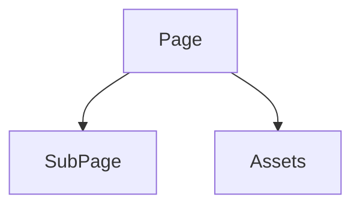

# NoteCraft v0.0.9 - Release Preview Draft

**Status:** Preview copy; release scope and verification are still in progress.

## Planned v0.0.9 focus

- Infinite canvas interaction for drawing in open page space.
- An Android preview.
- Continued language support work.

These are work-in-progress goals, not a final release checklist.

## NoteCraft overview

NoteCraft keeps notebooks in plain folders and pages in ordinary files. Choose HTML for rich
layout or CommonMark + GFM for readable diffs and merges. Your pages and their media stay
together, so you can use the sync and backup tools you already trust.

## Get started

- Create a notebook.
- Add sections and pages.
- Choose the default page format.
- Try attaching a picture.

## Why folders?

- A page and its media move together.
- Sub-pages nest without a limit.
- A backup is a copy.
- Notes should outlive the app that wrote them.

## Choose a page format

| Format | Extension | Good for |
| --- | --- | --- |
| HTML | `index.html` | Rich layout |
| CommonMark + GFM | `index.md` | Clean diffs and merges |

## Rich content

Inline equation: `E = mc^2`

Display equation:

```math
\int_0^1 x^2\,dx = \frac{1}{3}
```

Simple page structure diagram:



Use code freely, and cross things out with Markdown, like ~~this~~.

The release-preview GIF is generated from the Pillow script and the supplied background:
[RELEASE_NOTES.gif](RELEASE_NOTES.gif). Rebuild it with:

```sh
python docs/releases/0.0.9/art/generate-release-artwork.py
```
