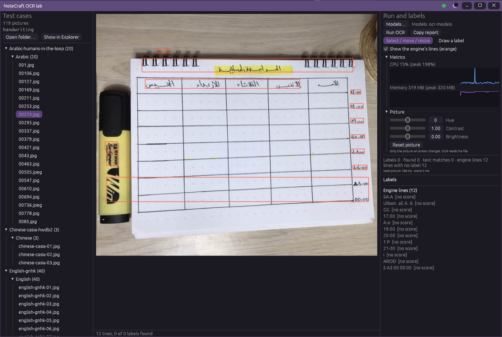
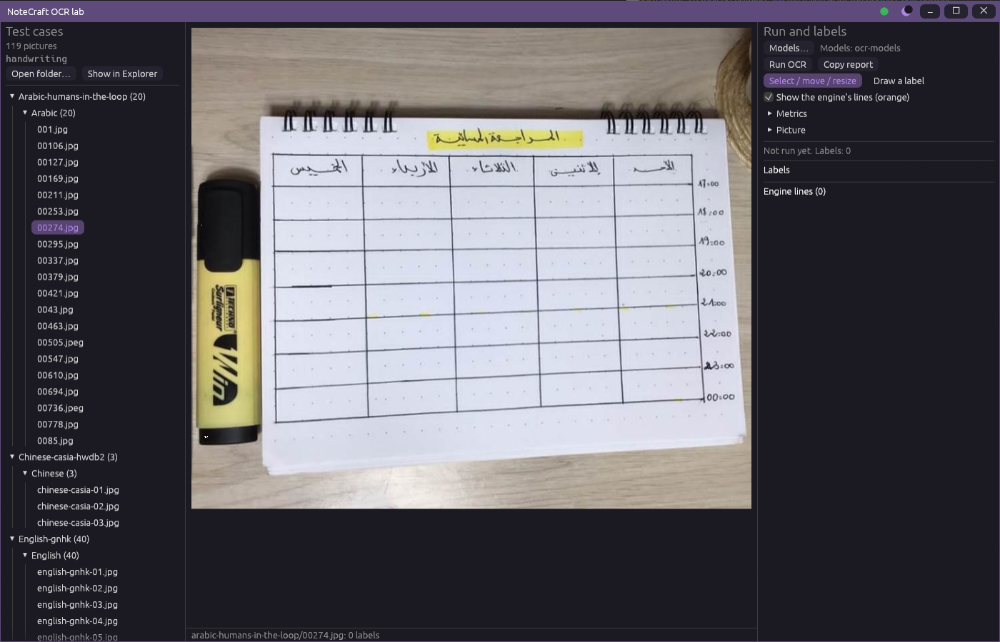

# NoteCraft OCR lab

A developer tool for testing and labelling OCR. It runs the product's own OCR code
(`notecraft-ocr`) on a folder of test pictures, shows what the engine reads over each picture, and lets
you draw and correct the true boxes and text. It is never shipped.

## Start it

```bash
run.cmd --ocr-lab
```

Flags are passed through: `--folder <dir>` for the test pictures, `--models <dir>` for the OCR model
folder. Without flags it reopens the last folder and models. You can also run
`cargo run -p notecraft-ocr-lab`.

Headless, with no window, for scripts:

```bash
cargo run -p notecraft-ocr-lab -- --check --folder <dir> --models <dir>
```

It prints one line per picture and exits 1 if any picture fails.

## The window



- **Title row.** Drag the bare bar to move the window, double-click it to maximise. The buttons at the
  right close, maximise and minimise. The sun or moon opens the theme chooser (the same 14 themes as
  the app). The light shows the model state.
- **Left: test cases.** The pictures grouped first by kind (the first folder, such as Handwriting) and
  then by language (from the folder names). A pencil marks a picture that has labels. Each group has
  an **Insert…** button for adding a picture of your own (see *Your own pictures*).
- **Middle: the picture.** Orange boxes are the engine's lines. Blue boxes are your labels. Yellow is
  the box you have selected.
- **Right: run and labels.** Run OCR, copy the report, switch between select and draw, and see the
  score: how many labels the engine found, how many text matches, and how many lines have no label.
  Under it are the metrics (CPU and memory of this process while it runs), the picture sliders, your
  labels and the engine's lines.



## Models

The header light is green when both OCR model files are present and match their checksums, amber when
one is missing, red when one is wrong, and grey when no folder is set. Hover it for the reason.
**Download models** fetches the two public files (about 12 MB) into `tools/ocr-lab/local/models`, checks
them, and loads them. Nothing downloads until you press it. The weights are CC BY-SA 4.0; see the OCR
skill.

Open **Models** in the right panel to see what is loaded. For each of the two files it shows its
role (detection or recognition), its size on disk against the size and SHA-256 it must have, what it
can read, and links to its source and licence, which open in your browser. With no folder set, or a
file missing, it says so and still lists what is expected. The facts sit beside the checksums in
`src/models.rs`, so they change together.

## Your own pictures

Press **Insert…** in a group of the test cases to add a picture to it:

- **Picture from a file…** takes a PNG or JPEG.
- **Draw a picture** opens a white canvas. Draw with the mouse, a pen or a finger; **Clear the
  drawing** starts again. The drawing is saved as a PNG.

Then choose where it goes:

- **Keep it on this computer only** (the default) puts it under `local/inserted/`, which is
  git-ignored. It is listed in the same group, marked *(this computer)*, and comes back next time for
  the same test folder.
- **Put it in the test folder** copies it beside the group's other pictures, where git sees it. Give
  where it comes from and its licence: both are written to that folder's `SOURCES.txt`, as for every
  test picture. Nothing goes into the repository unless you choose this.

Either way, run OCR on it and label it as on any picture: its labels and runs are kept beside it.

## Labels

- **Draw a label:** choose *Draw a label*, then drag on the picture.
- **Select, move, resize:** choose *Select / move / resize*, click a label, drag it, or drag a corner.
  Press Delete to remove the selected label.
- **Text and colour:** select a label in the right panel. Type its text, and use the colour button next
  to it to change its box colour.
- Labels are saved beside each picture as `<picture>.label.json` as soon as you change them.

## Picture sliders

Under **Picture** in the right panel: **Hue**, **Contrast** and **Brightness**, with **Reset picture**.
They change only the picture on screen, so you can see faint handwriting. OCR reads the original file.

## Runs

A run is saved beside its picture as `<picture>.ocr-run.json` with the picture's checksum. Reopening the
picture shows the last result without reading it again. If the picture file changes, the old run is
ignored.

## Where things live

Everything local is under `tools/ocr-lab/local/`, which is git-ignored:

| Path | What it is |
|---|---|
| `settings.json` | The folder, models and theme you last used |
| `ocr-lab.log` | The event log |
| `reports/` | Reports written by **Copy report** |
| `models/` | Models downloaded by **Download models** |
| `inserted/` | Pictures added with **Insert…** and kept on this computer, one folder per test folder |

The test pictures stay in their own folder. Each case folder has a `SOURCES.txt` that records where every
picture came from and its licence.

## Language of the lab

The lab's own labels and messages are English only. It is a developer tool that is never shipped, so
it is outside the app's translation audit (`cargo xtask i18n-audit` covers the app's source only). This
is a decision, not an oversight; a translation would need a reason to ship.

## Checks

```bash
cargo test -p notecraft-ocr-lab
cargo xtask ocr-check
```

`ocr-check` runs these tests and, when the models are set, the headless read of the smoke pictures.
